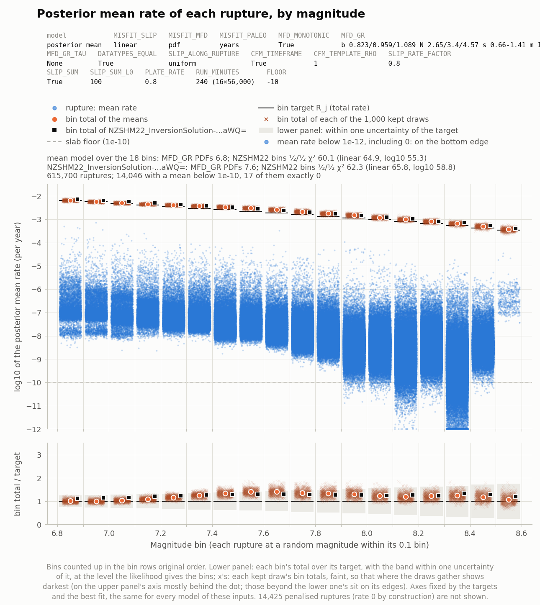

# Posterior sampling of NZSHM22 rupture rates

## Why this workflow

The 2022 New Zealand National Seismic Hazard Model (NZSHM22) builds its fault-based earthquake rates by an inversion (Gerstenberger et al., 2022, 2024) that follows the UCERF3 recipe (Field et al., 2014; Page et al., 2014), as implemented in OpenSHA (Milner and Field, 2023). Every rupture in a rupture set (411,270 for the crustal faults) is given an annual rate so that the predicted fault slip rates, paleoseismic event rates and a regional magnitude-frequency distribution (MFD) match their targets; the MFD is built from the regional rate N of M ≥ 5 earthquakes and a b-value, less the share that falls off the modelled faults or below their ruptures’ magnitudes. The problem is a linear system *G m* ≈ *d*, each row divided by its uncertainty, with far more unknowns than independent data. NZSHM22 solves it by simulated annealing: fast simulated annealing (Szu and Hartley, 1987) from all rates at zero, each step perturbing a rate by a random order of magnitude between 10−10 and 10−2 times a uniform number in ±0.5; four threads, the best of them chosen about every second; four such inversions averaged every 30 seconds; about 3 billion iterations in all; and, for the crustal faults, constraint weights rebalanced as it runs so that the slip rates, the MFD and the paleo rates end up fit equally well relative to their uncertainties. Each logic-tree branch gets one solution, with a few hundred to about 1,700 crustal ruptures at non-zero rates.

That gives a sound model for each branch, but leaves three things this workflow sets out to supply:
- **The range of rupture rates the data allow, carried into hazard.** The data fix sums of rates (on a fault, in a magnitude bin) far better than single rates: here *G* has rank 2,372 for 615,700 unknowns. Each annealing run lands on a different model, depending on its random seed (Gerstenberger et al., 2022), and the averaging of threads widens what one run covers, but the result is still one rate vector per branch, with no statement of how far others could differ while fitting the data as well. This workflow samples the whole set as a Bayesian posterior: every rupture rate and every derived quantity gets a mean and a spread, and weighted representative models (step 8) carry that spread into hazard calculations alongside the logic tree.
- **Whether sparse solutions are warranted.** In UCERF3 a single annealing run put only about 4% of ruptures above their minimum ("water level") rates; averaging 10 runs of the same branch raised that to about 38,000 ruptures and averaging 200 runs to about 115,000, because different runs fit the data equally well with different subsets (Page et al., 2014). The sparsity of one solution therefore reflects the search, a start from zero and a stop once the data are fit, at least as much as the data. Here the spike-and-slab prior lets each rupture be exactly off or on, and estimates the fraction on in each magnitude bin from the data, so the number of active ruptures is an outcome: in this run about 1,477 ruptures are on in each draw, but which ones varies from draw to draw. Single draws may still be fairly sparse, depending on what counts as a negligible rate (the slab floor is 10−10 per year; a single rupture becomes detectable in the data nearer 10−5), but their sparsity is now the outcome of a stated prior and the data, rather than of the way it emerges from the annealing.
- **Freedom from the annealing’s settings.** The perturbation function, the cooling schedule, the starting model, the number of iterations, the intervals of thread selection and averaging, and the rule for rebalancing the constraint weights all shape the solution. They were chosen for fast, reliable convergence (the report notes that other starting models gave unacceptable fits and were set aside), not tested as sources of uncertainty. A posterior does not depend on how it is sampled: the length of a run sets only its precision, which the convergence checks measure (step 6). The choices that remain are stated as a prior or a likelihood, each a setting in the notebook (each data type scored in the space its uncertainties were worked out in, the MFD from N and b, the plate rate, and so on), so each can be tested.

## The Gibbs sampler, and why it suits this problem

A Markov chain Monte Carlo (MCMC) sampler draws a sequence of models whose distribution settles on the posterior: the models that fit the data, each weighted by how well it fits and by the prior. A Gibbs sampler does it one unknown at a time: it draws each rupture’s rate from its exact distribution given all the other rates and the data, then moves to the next rupture; one sweep updates all 615,700 rates. Three things make that efficient here:
- **Each update is exact and cheap.** A rate enters the predictions linearly, so with the others fixed its misfit is a quadratic in it (or, for the terms scored in log space, a smooth one-dimensional function), and one rupture’s column of *G* holds only 47 nonzero entries on average. With each chain’s residuals kept current, an update reads one sparse column and draws from a one-dimensional distribution exactly: there is no step size to tune and no update wasted by a step that was too large.
- **Hard constraints become simple limits.** Positivity, the monotonic MFD and the plate rate each become, for one rate with the others fixed, a range of allowed values, so every draw keeps them exactly instead of paying a penalty for breaking them.
- **Switching a rupture on or off is part of its update.** Under spike-and-slab each update decides exactly whether the rupture is off or on, so the chains move between sparser and denser models as the data allow.

**Why in log rate.** The rates that matter span 6.5–7.8 decades, from the slab floor of 10−10 per year up to each magnitude bin’s target. Each rupture that is on is updated by a slice sampler (Neal, 2003) in the logarithm of its rate, so its steps are proportional to its own size: a rate near 10−8 per year and one near 10−3 move equally readily in relative terms, where any fixed step in linear rate would be far too large for the first or far too small for the second. The prior is uniform in log rate as well, so the update works in the variable the prior is flat in. Log space also matches what matters downstream: hazard responds to rates over orders of magnitude, and the MFD and paleo misfits are themselves scored partly in log space.

**Where it is slow.** One rate at a time is slow where rates are strongly correlated. Near-duplicate ruptures (4,049,054 pairs with cosine similarity above 0.99) can trade rate between them almost freely, which single-rate updates do only in small steps; swap moves, which exchange two such ruptures’ rates in one step, address this. The slowest quantities are the fractions of ruptures on in the highest magnitude bins, which change only as individual ruptures switch (step 6).

## Other ways to explore the model space

The sampler was chosen for the shape of this problem: hundreds of thousands of unknowns, a sparse linear forward model, exact zeros and hard limits. How other approaches would fare, judged from how they scale (none was run here):
- **Simulated annealing** (NZSHM22, UCERF3) is an optimizer. Each run gives one well-fitting model, and many runs give many, but their spread reflects the search (the seed, the start, the stopping point) rather than a stated probability, so it cannot say how likely each model is or when the range of solutions has been covered. Its cost is set by the cooling schedule and the number of iterations.
- **Random-walk Metropolis** on all rates at once must take steps small enough for the most tightly fit direction; with 615,700 unknowns whose scales differ by many decades, nearly every proposal is rejected or barely moves. It is impractical at this size.
- **Hamiltonian Monte Carlo (HMC) and its adaptive form, the No-U-Turn Sampler (NUTS)** (Neal, 2011; Hoffman and Gelman, 2014) move all rates together along the gradient of the log posterior, which here costs about one sparse product with *G*T, comparable to a Gibbs sweep, and they excel on smooth, correlated posteriors. Three features of this problem work against them: the exact zeros of spike-and-slab are discrete, which HMC cannot sample without replacing the prior by a continuous one; the hard limits (positivity, the monotonic MFD, the plate rate) need reflections or transformations, and a transformation to log rate makes a sharp funnel near the floor; and the step size is set by the stiffest direction (sums of rates fit within a few percent) while the loosest (single rates unresolved over many decades) then need thousands of steps, unless a mass matrix over 615,700 unknowns can be tuned. Without spike-and-slab and with a good mass matrix it could compete; as the model stands, its single point of slowdown is the discreteness.
- **The Neighbourhood Algorithm** (Sambridge, 1999a, 1999b) searches, and then appraises the ensemble, by dividing parameter space into Voronoi cells around the models tried. It is effective for tens of unknowns; with 615,700 it cannot cover the space, and its geometry grows costly with the number of unknowns.
- **Ensemble samplers** such as the affine-invariant sampler (Goodman and Weare, 2010) need more walkers than twice the number of unknowns, over a million here, so they do not scale to this problem. **Parallel tempering** helps when the posterior has separated modes; it runs an inner sampler such as this one at several temperatures and multiplies the cost by their number, so it is an option to add, not a replacement.
- **Analytic and approximate posteriors** (Gaussian, Laplace, variational) are fast, but the exact zeros, the hard limits and the posterior’s long tails toward zero break their assumptions. Without positivity the linear-Gaussian posterior could be written down directly; it serves as a check, not as the answer.

For the Gibbs sampler the single point of slowdown is correlation that its one-at-a-time updates cannot cross in one move: near-duplicate ruptures (handled by the swaps) and the fraction on in each bin. Its cost per sweep grows only with the number of nonzero entries in *G*, so it scales to the full rupture sets.

*References.* Field, E. H., et al. (2014). Uniform California earthquake rupture forecast, version 3 (UCERF3): the time-independent model, *Bull. Seismol. Soc. Am.* 104, 1122–1180. Gerstenberger, M. C., et al. (2022). The seismicity rate model for the 2022 New Zealand National Seismic Hazard Model, *GNS Science Report* 2022/47, doi:10.21420/2EXG-NP48. Gerstenberger, M. C., et al. (2024). The seismicity rate model for the 2022 Aotearoa New Zealand National Seismic Hazard Model, *Bull. Seismol. Soc. Am.*, doi:10.1785/0120230165. Goodman, J., and J. Weare (2010). Ensemble samplers with affine invariance, *Commun. Appl. Math. Comput. Sci.* 5, 65–80. Hoffman, M. D., and A. Gelman (2014). The No-U-Turn Sampler, *J. Mach. Learn. Res.* 15, 1593–1623. Milner, K. R., and E. H. Field (2023). A comprehensive fault-system inversion approach: methods and application to NSHM23, *Bull. Seismol. Soc. Am.*, doi:10.1785/0120230122. Neal, R. M. (2003). Slice sampling, *Ann. Stat.* 31, 705–767. Neal, R. M. (2011). MCMC using Hamiltonian dynamics, in *Handbook of Markov Chain Monte Carlo*, CRC Press, 113–162. Page, M. T., et al. (2014). The UCERF3 grand inversion: solving for the long-term rate of ruptures in a fault system, *Bull. Seismol. Soc. Am.* 104, 1181–1204. Sambridge, M. (1999a, 1999b). Geophysical inversion with a neighbourhood algorithm, I and II, *Geophys. J. Int.* 138, 479–494 and 727–746. Szu, H., and R. Hartley (1987). Fast simulated annealing, *Phys. Lett. A* 122, 157–162.

## This run, step by step

This workflow maps the whole set of models consistent with the data and a stated prior, reporting posterior means and spreads of every rupture rate, of every predicted datum and of sums such as fault event rates, together with weighted representative models for hazard calculations. The sections below follow the notebook `cru_workflow.ipynb` step by step for one run; each figure is one this run wrote.

## 1. Inputs and configuration

The inputs are the inversion matrices in `NZSHM22_Matrices-630k`: `cru_A.txt` (*G*, 16,851 rows by 630,125 ruptures, 29.4 million nonzeros) and `cru_D.txt` (*d*). The rows are the subsections’ slip rates, the MFD bins, the paleoseismic event rates, and penalty rows that force some ruptures to zero. The OpenSHA solution for the same rupture set (`NZSHM22_InversionSolution-630k`) supplies the fault geometry and named faults for the figures, and a reference model drawn in black on every figure. One configuration cell sets everything; this run used:

| setting | value | meaning |
|---|---|---|
| SLIP_SECTIONS | 'auto' | how the slip-rate rows count (’auto’: each fault section’s slip rate as one measurement, however many subsections it is copied to) |
| MFD_UNCERTAINTY | 'as-given' | the MFD bins’ uncertainty level (’as-given’: as the inputs give them) |
| MISFIT_SLIP | 'linear' | the slip rates scored linearly, by their split normals; every prediction kept above zero |
| MISFIT_MFD | 'half' | half linear, half log: half their Gaussians plus half the Gaussian in log10, the geometric mean of the two densities, with the same sds; every prediction kept above zero |
| MISFIT_PALEO | 'years' | the paleo rows scored by each site’s recurrence-interval PDF in years; every prediction kept above zero |
| CFM_SLIPRATES | True | each slip rate a split normal in mm/yr from the NZ Community Fault Model corrected for its timeframe (CFM_TIMEFRAME) and scaled as a whole by 0.8, the slip sums too |
| CFM_TIMEFRAME | True | each fault’s slip rate corrected for its timeframe (Coffey et al.): a split normal fitted to the corrected distribution’s 16%, 50% and 84% points (its median and body exactly), no further multiplier |
| CFM_TEMPLATE_RHO | 1 | faults of quality codes 2–5 sharing an identical SR_pref / SR_min / SR_max treated as correlated, each one’s rows weighted 1/√(1 + (n − 1) × 1) for a group of n |
| CFM_RATE_LINKS | True | also the faults of any quality code whose rate the CFM borrowed from another’s (named in its comment as the source, or an identical triple on an adjacent trace or a fault of the same name), each weighted 1/√(1 + m × ρ) for the m faults it is correlated with |
| SLIP_RATE_FACTOR | 0.8 | the assumed fraction of each fault’s slip rate the ruptures take up, scaling each slip-rate distribution as a whole, target and sd (the inputs’ own) |
| MFD_MONOTONIC | True | no magnitude bin’s total above its lower neighbour’s where the targets do not rise (a hard constraint, gibbs.py --mfd-monotonic) |
| CROSS_SECTIONS | 'all' | the strips of cross-sections perpendicular to the plate motion that SLIP_SUM and PLATE_RATE use, 8.5 km wide over all of New Zealand |
| SLIP_SUM | True | the slip along the plate motion (each fault’s slip vector projected on it) summed along each cross-section perpendicular to it, against the targets’ sums (a soft term) |
| SLIP_SUM_L0 | 100 | the summed slip rates’ weight: each 100 km of the plate boundary counts as one measurement |
| PLATE_RATE | 0.8 | each strip’s share of the plate rate at most 0.8 (a hard constraint, gibbs.py --plate-rate; PLATE_RATE = True: at SLIP_RATE_FACTOR) |
| DOWN_THE_MIDDLE | False | no balance term: the Gaussian misfit alone |
| FLOOR | -10 | the lowest rate an active rupture can take, 10-10 per year |
| PRESET | 'very_conservative' | 1 replicates × 16 chains × 100,000 sweeps (burn-in 5,000, a draw kept every 32) |
| REPRESENTATIVES | 100 | weighted representative models selected for hazard |

## 2. Cleaning and diagnostics

Cleaning (`preliminaries.py`) turns the raw system into the problem the sampler sees. The 17 penalty rows with very large entries fix 14,418 ruptures at zero, and 7 soft zero-forcing rows fix 7 more, so 14,425 ruptures are removed (at rate 0 in every output). 14,432 rows that then hold no remaining rupture add a constant χ² of 292.3 that no model can change, and are dropped. What remains is 2,395 rows by 615,700 ruptures: 2,312 slip-rate rows, 18 MFD bins and 65 paleo rows. The slip-rate rows form 551 fault sections; each section’s rows are divided by √k for its k subsections, so a section’s slip rate counts once rather than k times. The MFD bin targets run from 0.00034 to 0.0064 per year and sum to 0.0417 per year, with relative uncertainties of 9.3% to 19.4%. If the stated uncertainties are right, a model drawn from the posterior should have χ² near 382 ± 26: this is the *fit check*, for the Gaussians; with the paleo rows scored by their sites’ recurrence-interval PDFs, each site’s own expected misfit replaces its Gaussian share in the fit check used below (section 7). The diagnostics (`prelim.png` in the run folder, not shown here) show how weakly individual rates are determined: *G* has rank 2,372, and the median diagonal of the resolution matrix is 0.002, so the data fix sums of rates far better than single rates. There are also 4,049,054 pairs of near-duplicate ruptures (cosine similarity above 0.99), which the sampler handles with swap moves.

## 3. The best fit (no prior)

Cleaning also computes the best nonnegative least-squares fit (Lawson–Hanson NNLS, 53 s). It reaches χ² = 158.3 over the 2,395 rows with only 869 ruptures above zero: 94.4 from the slip rates, 15.3 from the MFD bins and 48.7 from the paleo rows. Its total rate is 0.0458 per year, +9.8% against the bin targets, with every bin between +5.4% and +17.4%. A fit chooses among all the rates to match far fewer numbers, so its χ² lies well below the fit check; it is a reference with no prior and the starting point of the chains, not a sample of the posterior. Its fit to each data type is drawn in the run’s `nnls/` folder (not shown here); the posterior’s follows in step 9.

## 4. The model: prior, likelihood and constraints

**Prior.** Each rupture is either off, with a rate of exactly zero, or on, with a rate that is uniform in log rate from 10-10 per year up to its magnitude bin’s target rate (spike-and-slab). The top is soft, a Gaussian shoulder as wide as the bin’s own uncertainty, since no single rupture can carry more than its bin’s total. The fraction of ruptures switched on is estimated separately in each bin (uniform prior on each fraction), so the data decide how many ruptures are active, and the prior puts no pressure on the bin totals. **Likelihood.** Gaussian, exp(−χ²/2) with the stated uncertainties. **Positivity.** In addition, each subsection’s slip rate, each paleo rate and each MFD bin must be above zero, so at least one rupture is on in each, with no other limit: a hard constraint. **The paleo misfit.** The paleo rows leave the Gaussian likelihood: each is scored instead by its site’s recurrence-interval PDF from the paleoseismic analysis, −2 ln of its density in years, measured from its minimum, a curve through the site’s 2.275, 15.865, 84.135 and 97.725% points with its mode at 1/bestEstimate exactly (the rupture set’s paleo_constraint_data.json); 2 site(s) fit their quantiles to worse than 0.05 decades. The ranges are lopsided, and the Gaussian caps a site’s misfit, so this penalizes paleo rates predicted well below their targets far more. It is kept exactly by the same Metropolis steps as the soft band, and recorded apart; χ² still counts the paleo rows’ Gaussian misfit, for comparison. **Misfit by data group** (MISFIT_SLIP 'linear', MISFIT_MFD 'half', MISFIT_PALEO 'years'). The slip rates are scored by their split normals; the MFD bins by half their Gaussians and half a Gaussian in log10 with the same sds; the paleo rows by their recurrence-interval PDFs in years. A half-and-half group’s score is the geometric mean of its two densities, so each measurement still counts once; away from a target a log part grows with the decades off. Every prediction is kept above zero, each log part is kept exactly by Metropolis steps, and χ² as fitted counts every part. **Slip rates from the CFM.** Each subsection’s slip-rate row is rebuilt from its parent fault’s line of the NZ Community Fault Model (SR_pref, SR_min, SR_max in mm/yr): a split normal in the slip rate itself, scaled as a whole by 0.8 (SLIP_RATE_FACTOR, the assumed fraction of the slip rate the ruptures take up): each fault’s numbers corrected for its slip-rate timeframe (CFM_TIMEFRAME; Coffey et al.: the CFM’s range widened by the distribution of true over measured slip rate for the few earthquakes a short timeframe captures, rebuilt in full from the paper’s Table S4), and the split normal fitted to that corrected distribution: through its 16%, 50% and 84% points, or, for the most right-skewed faults, fitted in log10 of the slip rate and converted, whichever is closest to it in Kullback–Leibler divergence (its median and body exactly for most faults), times 0.8. The inputs’ Gaussian has one sd, twice the half range, for both sides; here each side has its own, and their mean is the unit of the rows, of χ² and of the summed slip rates, which sum the modes. The misfit, each residual weighed by its own side’s sd, is evaluated exactly in every update. **A monotonic MFD.** Wherever a magnitude bin’s target is not above the next lower bin’s, its total rate may not be either, in every model. **The plate rate.** In each 8.5-km strip of cross-sections perpendicular to the plate motion over all of New Zealand, the crustal faults must take up at most 0.8 of the Pacific–Australia plate rate, each fault’s slip vector projected on the local plate motion and averaged over the strip’s cross-sections (`plate_rate.txt`). **Summed slip rates.** A soft term in the misfit: along every cross-section perpendicular to the plate motion over all of New Zealand, the model’s slip along the plate motion added up (each fault’s slip vector projected on it) should match the targets’ added up, within that sum’s uncertainty, each subsection counting once in all; each 100 km of the plate boundary counts as one measurement, and it is recorded apart from χ² (`plate_rate.txt`).

## 5. Sampling

The sampler (`gibbs.py`, a C kernel run from Python) is an exact Gibbs sampler: it updates one rupture at a time, drawing its rate from its exact conditional distribution by a slice sampler in log rate, with an exact step that switches the rupture on or off. Each update is restricted to the rates that keep the hard constraints (no slip-rate or paleo or MFD bin row predicted at zero, the MFD’s monotonicity, the plate-rate limit). The summed slip rates are quadratic in the rates, so they enter the exact updates as extra rows of the misfit. Swap moves exchange the rates of near-duplicate ruptures (2,991,269 pairs; 0.2% of swaps accepted), and the fraction on in each bin is redrawn after every sweep. The chains start from the best fit, with 7 ruptures switched on at twice the slab floor so that none of the 45 rows it predicts at zero is left there; in 16 of 16 chains it took up more than the plate-rate limit, and their rates were scaled down (by a factor 0.955 at most). Each of the 1 replicates ran 16 chains for 100,000 sweeps in 5.8 hours, keeping 2,969 draws per chain after burn-in: 47,504 recorded draws in all. No recorded draw broke the hard constraints. The runs keep running summaries rather than every draw, plus whole draws for the representative models and the figures.

## 6. Convergence

`check_convergence.py` judges each replicate against the targets of its preset: verdicts main_rep0 CHECK (main_rep0: R-hat of the ruptures on or of a bin's fraction on 1.0225 (below 1.01 needed); each bin's fraction on needs 4,000 effective draws (fewest 721)). For χ² and the total rate the effective sample sizes are 12,090 and 20,820 per replicate, and for the rupture rates the 5th percentile is 40,660. About 1,477 ruptures are on in each draw. With so many rates even perfectly independent draws give a worst R̂ above 1, so R̂ is judged against that noise baseline (1.0006 here). A small minority of ruptures mixes slowly, mostly ruptures that switch on and off rarely: 149 ruptures per replicate with R̂ above the threshold (worst 1.129), carrying 14.0% of the total rate, with at least 391 effective draws each. 

| replicate | χ² (mean) | effective draws: χ² / total rate | worst R̂ (baseline) | slow-mixing ruptures (share of rate) | verdict |
|---|---|---|---|---|---|
| main_rep0 | 1032 | 12,090 / 20,820 | 1.1291 (1.0006) | 149 (14.0%) | CHECK |

## 7. Fit to the data

The posterior’s χ² as fitted is 1032.5 ± 35.9, against the fit check as fitted, 404.1 ± 27.2 (χ² as the likelihood scores the data: each group as MISFIT_SLIP, MISFIT_MFD and MISFIT_PALEO score it, with its own expected share; cleaning’s, for the Gaussians alone: 382 ± 26): above it (+23.1 standard deviations). A χ² above the fit check means some data are fitted worse than their uncertainties allow, or the uncertainties are too small. The row-block fit (`block_fit.py`) splits χ² by data type: a block’s χ² per measurement near 1 is fitted as its uncertainties say, below 1 more closely, above 1 worse. In the table, the “mean model” is the misfit of the posterior-mean prediction and the “spread” is the posterior variance of the predictions; the two add up to χ².

| row block | rows | measurements | χ² over the draws | per measurement | z | mean model | spread |
|---|---|---|---|---|---|---|---|
| slip rates (S) | 2,312 | 298.9 | 843.9 ± 35.7 | 2.82 | +24.7 | 400.7 | 443.2 |
| MFD bins (MFD) | 18 | 17.9 | 54.1 ± 10.2 | 3.03 | +6.1 | 45.4 | 8.7 |
| paleo (B8:var) | 65 | 87.3 | 134.5 ± 13.7 | 1.54 | +3.2 | 105.0 | 29.6 |
| total | 2,395 | 404.1 | 1032.5 ± 35.9 | 2.56 | +23.1 | 551.1 | 481.4 |

Each run also records the terms it adds beside χ², each on χ²’s scale and not counted in it. **The MFD misfit in log10**: 50.0 on average per replicate (5–95% of draws 36.4–65.2), in the likelihood weighted one half, beside half the bins’ Gaussian; χ² counts the whole Gaussian. **The paleo misfit**: 134.5 on average per replicate (5–95% of draws 112.8–157.9), in the likelihood in place of the paleo rows’ Gaussian, which χ² still counts. **The summed slip rates**: 29.1 on average per replicate (5–95% 22.3–37.6), against about 14.1 expected if the model matched the truth (one per 100 km of strip); `plate_rate.txt` lists the strips furthest from their target sums. **The plate rate**: every strip is inside the limits in 100.0% of the 1,000 kept draws, as a hard constraint requires; the strip closest to the limit, +59 (173.12° E, 41.81° S, mostly Hope and Awatere in the fault model), reaches 0.795 at the kept draws’ 97.5%.

## 8. Posterior tables, rate vectors and representative models

`make_tables.py` pools the replicates into per-rupture, per-subsection and per-bin tables and into rate vectors (`rate_vectors.csv`): for each of the 630,125 ruptures its posterior mean, median, mode and 2.3%, 15.9%, 84.1% and 97.7% points. Most ruptures are off in most draws, so their medians and modes are zero; sums such as fault or bin rates must be built from the means. The posterior-mean total rate is 0.0480 per year, +15.1% against the bin targets (NZSHM22_InversionSolution-630k: 0.0505); the bin totals sit a median +22.8% from their targets (+2.7% to +31.4%), against the best fit’s +13.2%. About 22% of each subsection’s posterior rate (the median) is carried by ruptures whose rates are individually below what the data can detect. `select_draws.py` then picks 100 weighted representative models from the 1,000 kept draws, clustering them by their rates per subsection and magnitude bin, for use in hazard calculations. With 100, the weighted mean total rate is off the exact mean by -0.0%, the worst bin by +2.2%, and 75% of subsection means are within 10% (the tolerance asks for 90%); the selection misses some tolerances, so the posterior-mean rate vector remains the exact input for mean hazard.

## 9. The posterior’s fit, data type by data type

The next three figures show the posterior’s fit to each data type. Each coloured dot is the posterior mean, and each faint x one of the kept draws, so where the draws gather shows darkest; open black squares are NZSHM22_InversionSolution-630k. **Rates by magnitude** (Figure 1): the posterior spreads each bin’s rate over many ruptures at low mean rates, where the best fit puts a few ruptures high and the rest at zero. The bin totals are +3.0% to +6.5% from their targets below M7.1 and +12.2% to +31.6% from M7.1 upward. **Slip rates** (Figure 2): 58% of the 551 sections’ posterior means lie within one measurement uncertainty of their targets and 87% within two (NZSHM22_InversionSolution-630k: 88% within one), with a median ratio of prediction to target of 0.88 (mean-model χ² 400.7; NZSHM22_InversionSolution-630k: 196.1). **Paleo rates** (Figure 3): the posterior underpredicts them, with a median ratio of prediction to target of 0.79; 66% of rows lie within one uncertainty and 91% within two (mean-model χ² 105.0; NZSHM22_InversionSolution-630k: 219.7).

*Figure 1.* Posterior: each rupture’s posterior mean rate against its magnitude bin (dashed: the slab floor; means below the axis, 0 included, on it), each bin’s target (black line) and total of the means (orange dot), and NZSHM22_InversionSolution-630k’s bin totals (black squares). Faint x’s: each kept draw’s bin totals. Lower panel: each bin’s total over its target. `fig_rate_magnitude.png`

*Figure 2.* Posterior: each fault section’s slip-rate target against its posterior-mean section mean (dots), in mm/yr, each target’s bar one sd either side. Faint x’s: each kept draw’s section means. Open squares: the reference. `fig_slip_rates.png`

*Figure 3.* Posterior: each paleo row’s target against its posterior-mean prediction (dots), in events per year, each target’s bars its site’s own 15.9–84.1% and 2.3–97.7% ranges. Faint x’s: each kept draw’s predictions. Open squares: the reference. `fig_paleo_rates.png`

## 10. Faults one by one

`plot_slip_sections.py` looks at 33 named faults, ordered from the most isolated (Greendale, which shares no rupture with any other section) to the most connected (Hope, which shares ruptures with 147). **Figures 4–5** sum each one’s rupture rates by magnitude bin, its rate of events of each size; the circles are the posterior means, the x’s the kept draws’ sums, and the strip marked 0 shows by its opacity how often a draw has no event in the bin.

*Figure 4.* Rupture rates by magnitude, first part: each column’s ruptures’ rates summed by magnitude bin for each kept draw (x’s), their posterior mean (circles) and the share of draws with no event in each bin (the strip marked 0), and the reference’s sums (black outline). `fig_slip_sections_ruptures_by_magnitude_1.png`

*Figure 5.* Rupture rates by magnitude, second part. `fig_slip_sections_ruptures_by_magnitude_2.png`

## 11. Output for OpenSHA

`make_solution.py` writes the posterior-mean rates as an OpenSHA fault-system solution’s rates file (`spikeslab/rates.csv`, one row per rupture of the rupture set, removed ruptures at zero), and the best fit’s as `nnls/rates.csv`. Before writing, it checks that the rates and the rupture set describe the same ruptures: 615,700 of 615,700 kept ruptures cross exactly the fault sections the rupture set lists, and each one’s magnitude lies in its bin. With `--zip` it also writes a complete archive that OpenSHA loads. Any representative model can be written the same way.

## 12. Points to keep in mind

- **The fit check.** χ² is +23.1 standard deviations from the fit check.
- **Paleo rates.** The posterior mean underpredicts them (median ratio 0.79).
- **Slow mixing.** 149 ruptures per replicate, carrying 14.0% of the total rate, mix slowly; their individual rates are less precise than the rest, though sums over many ruptures are not affected.
- **Convergence.** Not every replicate passes: main_rep0: R-hat of the ruptures on or of a bin's fraction on 1.0225 (below 1.01 needed); each bin's fraction on needs 4,000 effective draws (fewest 721) (the report suggests longer runs).
- **Starts.** All 16 chains started from the same point (the best fit, with ruptures switched on for positivity); runs from dispersed starts remain untested.
- **Representative models.** The 100 representatives miss some of their tolerances; the posterior-mean rate vector is the exact input for mean hazard.
- **What the data determine.** Sums of rates (fault, subsection and bin rates) and the probability that a rupture exceeds about 10−5 per year are well determined; individual rates below that are largely set by the prior.
