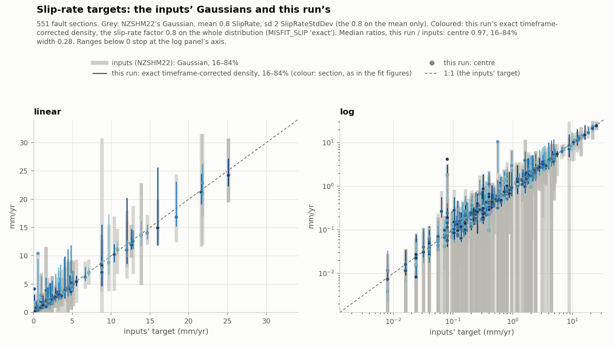
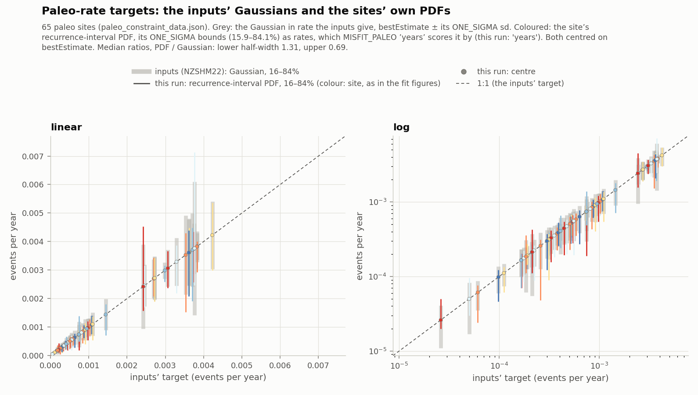
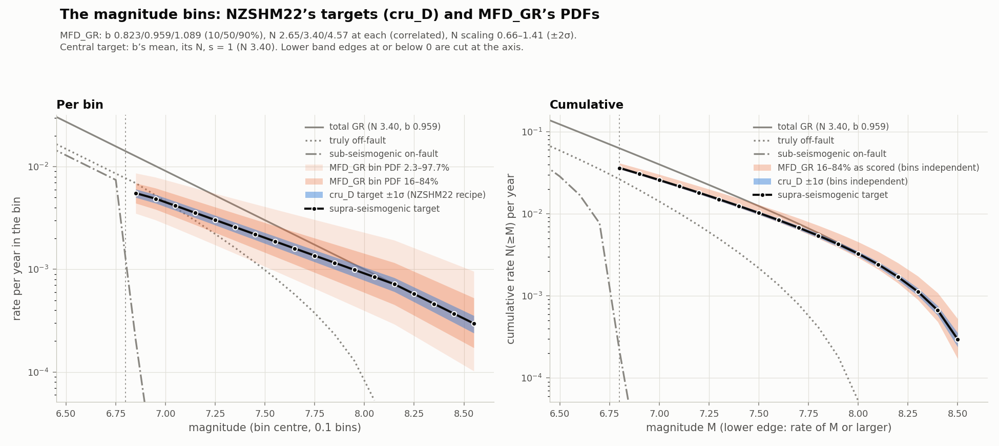
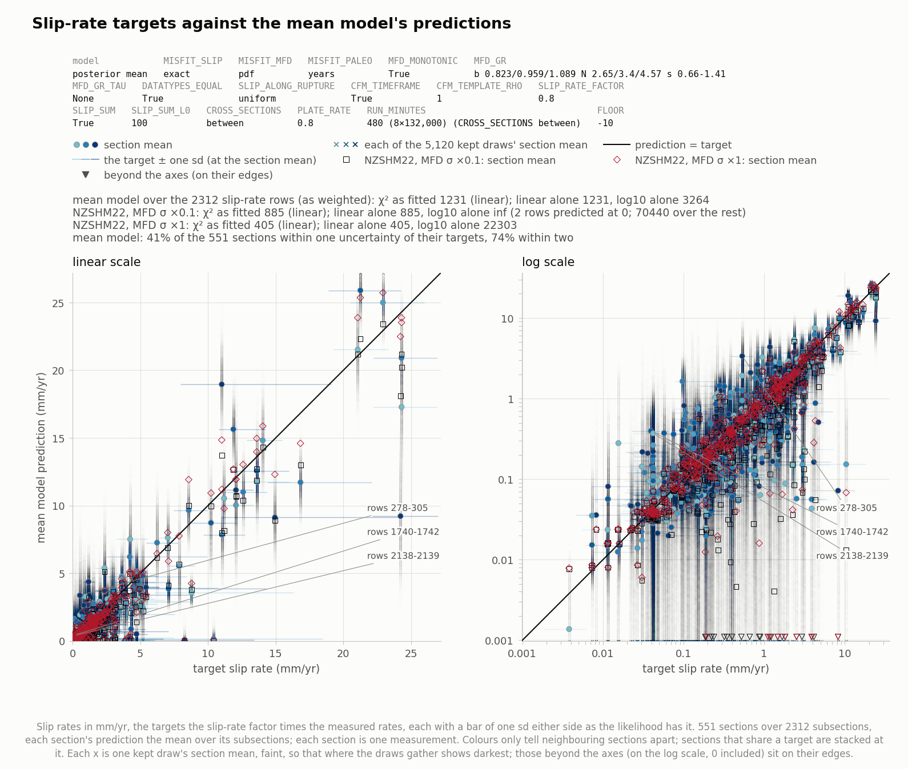

# Posterior sampling of NZSHM22 rupture rates

This workflow samples the Bayesian posterior of the annual rate of every rupture in an NZSHM22 rupture set, from the same constraints and a stated prior, with an exact Gibbs sampler. It is an alternative to the NZSHM22 inversion summarized below.

## Predecessors, and why this workflow

The 2022 New Zealand National Seismic Hazard Model (NZSHM22) builds its fault-based earthquake rates by an inversion (Gerstenberger et al., 2022, 2024) that follows the UCERF3 recipe (Field et al., 2014; Page et al., 2014) in OpenSHA (Milner and Field, 2023): each rupture in a rupture set (411,270 for the crustal faults) gets an annual rate such that the predicted slip rates, paleoseismic event rates and regional magnitude-frequency distribution (MFD, from a regional rate N of M ≥ 5 earthquakes and a b-value) match their targets: a linear system *G m* ≈ *d* with far more unknowns than independent data. NZSHM22 solves it by fast simulated annealing (Szu and Hartley, 1987) from all rates at zero, over about 3 billion iterations. Each logic-tree branch gets one solution, with a few hundred to about 1,700 crustal ruptures at non-zero rates.

That leaves three things this workflow sets out to supply:
- **The range of rates the data allow, carried into hazard.** The data fix sums of rates far better than single rates (here *G* has rank 2,372 for 615,700 unknowns). Each annealing run lands on a different model depending on its seed (Gerstenberger et al., 2022), but a branch keeps one. Here the whole set is sampled as a Bayesian posterior: every rate and derived quantity gets a mean and a spread, and weighted representative models (step 8) carry it into hazard.
- **Freedom from the annealing’s settings, weighting and nuances.** Combining slip rates, the MFD and paleo rates into one objective needs a weight on each, set subjectively for the subduction interfaces and, for the crustal faults, rebalanced as the inversion runs until each fits equally well relative to its uncertainties (by its own chosen misfit measure): either way a choice, to be treated as epistemic uncertainty (Gerstenberger et al., 2024). Here each datum counts by its own uncertainty in the likelihood, and this run then weights the data types to count equally (DATATYPES_EQUAL, step 4), a weighting fixed in advance by how many measurements each type has, not tuned to the fit, and the MFD bins’ uncertainties too come from N and b (MFD_GR). The annealing’s perturbations, cooling schedule, start and iteration count also shape its solution; a posterior does not depend on how it is sampled (step 6).
- **Ability to fit the constraints within their own inherent PDFs rather than as Gaussian misfits in rate.** The inversion scores every constraint as a Gaussian in rate: each slip rate with one symmetric sd; each paleo site with a symmetric sd about its best estimate, though its recurrence-interval PDF is lopsided (its one-sigma range a median 1.9 times longer below than above) and a Gaussian caps the cost of predicting no events there; each MFD bin with a set relative uncertainty. Here each is scored in the space its uncertainty was worked out in: slip rates by split normals from the NZ Community Fault Model (Seebeck et al., 2023), corrected for their timeframes (Coffey et al., accepted); paleo sites by −2 ln of their recurrence-interval PDFs in years; MFD bins half in rate and half in log10, or, with MFD_GR, by their own PDFs from N and b. The sampler evaluates each exactly.

## The Gibbs sampler, and why it suits this problem

A Markov chain Monte Carlo (MCMC) sampler draws a sequence of models whose distribution settles on the posterior: the models that fit the data, each weighted by how well it fits and by the prior. A Gibbs sampler does it one unknown at a time: it draws each rupture’s rate from its exact distribution given all the other rates and the data, then moves to the next rupture; one sweep updates all 615,700 rates. Three things make that efficient here:
- **Each update is exact and cheap.** A rate enters the predictions linearly, so with the others fixed its misfit is a quadratic in it (or, for the terms scored in log space, a smooth one-dimensional function), and one rupture’s column of *G* holds only 47 nonzero entries on average. With each chain’s residuals kept current, an update reads one sparse column and draws from a one-dimensional distribution exactly: there is no step size to tune and no update wasted by a step that was too large.
- **Hard constraints become simple limits.** Positivity, the monotonic MFD and the plate rate each become, for one rate with the others fixed, a range of allowed values, so every draw keeps them exactly instead of paying a penalty for breaking them.
- **Switching a rupture on or off is part of its update.** Under spike-and-slab each update decides exactly whether the rupture is off or on, so the chains move between sparser and denser models as the data allow.

**Why in log rate.** The rates that matter span 6.5–7.8 decades, from the slab floor of 10−10 per year up to each magnitude bin’s target. Each rupture that is on is updated by a slice sampler (Neal, 2003) in the logarithm of its rate, so its steps are proportional to its own size: a rate near 10−8 per year and one near 10−3 move equally readily in relative terms, where any fixed step in linear rate would be far too large for the first or far too small for the second. The prior is uniform in log rate as well, so the update works in the variable the prior is flat in. Log space also matches what matters downstream: hazard responds to rates over orders of magnitude, and the MFD and paleo misfits are themselves scored partly in log space.

**Where it is slow.** One rate at a time is slow where rates are strongly correlated. Near-duplicate ruptures (13,962,699 pairs with cosine similarity above 0.99) can trade rate between them almost freely, which single-rate updates do only in small steps; swap moves, which exchange two such ruptures’ rates in one step, address this. The slowest quantities are the fractions of ruptures on in the highest magnitude bins, which change only as individual ruptures switch (step 6).

## Other ways to explore the model space

The sampler suits this problem’s shape: hundreds of thousands of unknowns, a sparse linear forward model, exact zeros and hard limits. How other approaches would fare, judged from how they scale (none was run here):
- **Simulated annealing** (NZSHM22, UCERF3) is an optimizer: the spread of many runs reflects the search (seed, start, stopping point), not a stated probability.
- **Random-walk Metropolis** must step small enough for the most tightly fit direction; with 615,700 unknowns on scales many decades apart, nearly every proposal is rejected or barely moves.
- **Hamiltonian Monte Carlo and NUTS** (Neal, 2011; Hoffman and Gelman, 2014) move all rates along the gradient, at about a Gibbs sweep’s cost, and excel on smooth, correlated posteriors. But spike-and-slab’s exact zeros are discrete, which they cannot sample; the hard limits need reflections or transformations (log rate makes a funnel near the floor); and the stiffest direction (sums fit within a few percent) sets a step size that leaves the loosest (single rates unresolved over decades) thousands of steps from mixing. The discreteness is the single point of slowdown.
- **The Neighbourhood Algorithm** (Sambridge, 1999a, 1999b) partitions parameter space into Voronoi cells around the models tried: effective for tens of unknowns, unable to cover 615,700.
- **Ensemble samplers** (Goodman and Weare, 2010) need more walkers than twice the number of unknowns. **Parallel tempering** helps with separated modes, around an inner sampler such as this one, at several times its cost.
- **Analytic and approximate posteriors** (Gaussian, Laplace, variational) are fast, but the exact zeros, hard limits and long tails toward zero break their assumptions.
- **This Gibbs sampler**’s single point of slowdown is correlation its one-at-a-time updates cannot cross in one move: near-duplicate ruptures (handled by the swaps) and the fraction on in each bin. Its cost per sweep grows only with the nonzero entries of *G*, so it scales to the full rupture sets.

*References.* Coffey, G. L., et al. (accepted), Reassessing geologic fault slip rates and their uncertainties in Aotearoa New Zealand, *Bull. Seismol. Soc. Am.* Field, E. H., et al. (2014), *Bull. Seismol. Soc. Am.* 104, 1122–1180 (UCERF3). Gerstenberger, M. C., et al. (2022), *GNS Science Report* 2022/47, doi:10.21420/2EXG-NP48; (2024), *Bull. Seismol. Soc. Am.*, doi:10.1785/0120230165 (the NZSHM22 seismicity rate model). Goodman, J., and J. Weare (2010), *Commun. Appl. Math. Comput. Sci.* 5, 65–80. Hoffman, M. D., and A. Gelman (2014), *J. Mach. Learn. Res.* 15, 1593–1623. Milner, K. R., and E. H. Field (2023), *Bull. Seismol. Soc. Am.*, doi:10.1785/0120230122. Neal, R. M. (2003), *Ann. Stat.* 31, 705–767 (slice sampling); (2011), in *Handbook of Markov Chain Monte Carlo*, CRC Press, 113–162 (HMC). Page, M. T., et al. (2014), *Bull. Seismol. Soc. Am.* 104, 1181–1204 (the UCERF3 grand inversion). Seebeck, H., et al. (2023), *N. Z. J. Geol. Geophys.* (the NZ Community Fault Model, version 1.0). Sambridge, M. (1999a, b), *Geophys. J. Int.* 138, 479–494 and 727–746. Szu, H., and R. Hartley (1987), *Phys. Lett. A* 122, 157–162.

## This run, step by step

The sections below follow the notebook `cru_workflow.ipynb` step by step for one run; each figure is one this run wrote.

## 1. Inputs and configuration

The inputs are the inversion matrices in `NZSHM22_Matrices-630k`: `cru_A.txt` (*G*, 16,851 rows by 630,125 ruptures, 29.4 million nonzeros) and `cru_D.txt` (*d*). The OpenSHA solution for the rupture set (`NZSHM22_InversionSolution-630k`) supplies the fault geometry, the named faults and a reference model, drawn in black on every figure. One configuration cell sets everything; this run used:

| setting | value | meaning |
|---|---|---|
| SLIP_SECTIONS | 'auto' | how the slip-rate rows count (’auto’: each fault section’s slip rate as one measurement, however many subsections it is copied to) |
| MFD_GR | b 0.823 / 0.959 / 1.089 (10th percentile, mean, 90th percentile), the mean N(M≥5) conditioned on each 2.65 / 3.4 / 4.57 per year, N scaling 0.66–1.41 (2σ), magnitude-uncertainty factor 1 / 1.15294 / 1.30588 (equal weights) | each MFD bin scored by its own target PDF in log rate, propagated from b, N(M≥5) and the N scaling through NZSHM22’s partitioning of the total GR (less the off-fault and sub-seismogenic MFDs; mfd_gr.py), in place of cru_D’s targets (gibbs.py --mfd-misfit pdf) |
| MISFIT_SLIP | 'linear' | the slip rates scored linearly, by their split normals |
| MISFIT_MFD | 'half' | half linear, half log: half their Gaussians plus half the Gaussian in log10, with the same sds |
| MISFIT_PALEO | 'years' | the paleo rows scored by each site’s recurrence-interval PDF in years |
| CFM_SLIPRATES | True | each slip rate a split normal in mm/yr from the NZ Community Fault Model corrected for its timeframe (CFM_TIMEFRAME) and scaled as a whole by 0.8, the slip sums too |
| CFM_TIMEFRAME | True | each fault’s slip rate corrected for its timeframe (Coffey et al.): a split normal through the corrected distribution’s 16%, 50% and 84% points |
| CFM_TEMPLATE_RHO | 1 | faults of quality codes 2–5 with identical SR_pref / SR_min / SR_max correlated, each weighted 1/√(1 + (n − 1) × 1) in a group of n |
| CFM_RATE_LINKS | True | also faults whose rate the CFM borrowed from another (named as the source, or an identical triple nearby or of the same name), each weighted 1/√(1 + m × ρ) for its m correlated faults |
| SLIP_RATE_FACTOR | 0.8 | the assumed fraction of each fault’s slip rate the ruptures take up, scaling each slip-rate distribution as a whole, target and sd (the inputs’ own) |
| MFD_MONOTONIC | True | no magnitude bin’s total above its lower neighbour’s where the targets do not rise (a hard constraint, gibbs.py --mfd-monotonic) |
| DATATYPES_EQUAL | True | each data group’s log likelihood weighted so that the slip rates (with the summed slip rates), the MFD bins and the paleo rates count equally, each a third of their effective measurements in all (gibbs.py --group-weights); χ² as fitted and each group’s misfit are reported unweighted |
| SLIP_ALONG_RUPTURE | 'uniform' | each rupture’s slip spread along its subsections: the same average slip on each, as the inputs have it |
| CROSS_SECTIONS | 'all' | the strips of cross-sections perpendicular to the plate motion that SLIP_SUM and PLATE_RATE use, 8.5 km wide over all of New Zealand |
| SLIP_SUM | True | the slip along the plate motion (each fault’s slip vector projected on it) summed along each cross-section perpendicular to it, against the targets’ sums (a soft term) |
| SLIP_SUM_L0 | 100 | the summed slip rates’ weight: each 100 km of the plate boundary counts as one measurement |
| PLATE_RATE | 0.8 | each strip’s share of the plate rate at most 0.8 (a hard constraint, gibbs.py --plate-rate; PLATE_RATE = True: at SLIP_RATE_FACTOR) |
| FLOOR | -10 | the lowest rate an active rupture can take, 10-10 per year |
| RUN_MINUTES | 240 | the run’s length; 1 replicate × 16 chains × 56,000 sweeps (burn-in 5,000, a draw kept every 17), planned from a calibration (0.206 s per sweep) to take about 215 min in all |
| TARGETS | 'production' | the convergence verdict’s targets (check_convergence.py) |
| REPRESENTATIVES | 100 | weighted representative models selected for hazard |

## 2. Cleaning and diagnostics

Cleaning (`preliminaries.py`) turns the raw system into the problem the sampler sees. The 17 penalty rows with very large entries fix 14,418 ruptures at zero, and 7 soft zero-forcing rows fix 7 more, so 14,425 ruptures are removed (at rate 0 in every output). 14,432 rows that then hold no remaining rupture add a constant χ² of 292.3 that no model can change, and are dropped. What remains is 2,395 rows by 615,700 ruptures: 2,312 slip-rate rows, 18 MFD bins and 65 paleo rows. The slip-rate rows form 551 fault sections; each section’s rows are divided by √k for its k subsections, so a section’s slip rate counts once rather than k times. The MFD bin targets run from 0.00034 to 0.0064 per year and sum to 0.0417 per year, with relative uncertainties of 25.8% to 76.2%. If the stated uncertainties are right, a model drawn from the posterior should have χ² near 411 ± 27: this is the *fit check*, for the Gaussians; with the paleo rows scored by their sites’ recurrence-interval PDFs, each site’s own expected misfit replaces its Gaussian share in the fit check used below (section 7). The diagnostics (`prelim.png` in the run folder, not shown here) show how weakly individual rates are determined: *G* has rank 2,372, and the median diagonal of the resolution matrix is 0.002, so the data fix sums of rates far better than single rates. There are also 13,962,699 pairs of near-duplicate ruptures (cosine similarity above 0.99), which the sampler handles with swap moves.

## 3. The best fit (no prior)

Cleaning also computes the best nonnegative least-squares fit (Lawson–Hanson NNLS, 65 s). It reaches χ² = 127.6 over the 2,395 rows with only 1,017 ruptures above zero: 72.3 from the slip rates, 17.9 from the MFD bins and 37.5 from the paleo rows. Its total rate is 0.0571 per year, +36.9% against the bin targets, with every bin between −10.0% and +57.3%. A fit chooses among all the rates to match far fewer numbers, so its χ² lies well below the fit check; it is a reference with no prior and the starting point of the chains, not a sample of the posterior. Its fit to each data type is drawn in the run’s `nnls/` folder (not shown here); the posterior’s follows in step 9.

## 4. The model: prior, likelihood and constraints

**Prior.** Each rupture is either off, with a rate of exactly zero, or on, with a rate that is uniform in log rate from 10-10 per year up to its magnitude bin’s target rate (spike-and-slab). The top is soft, a Gaussian shoulder as wide as the bin’s own uncertainty, since no single rupture can carry more than its bin’s total. The fraction of ruptures switched on is estimated separately in each bin (uniform prior on each fraction), so the data decide how many ruptures are active, and the prior puts no pressure on the bin totals. **Likelihood.** Gaussian, exp(−χ²/2) with the stated uncertainties. **Positivity.** In addition, each subsection’s slip rate, each paleo rate and each MFD bin must be above zero, so at least one rupture is on in each, with no other limit: a hard constraint. **The paleo misfit.** The paleo rows leave the Gaussian likelihood: each is scored instead by its site’s recurrence-interval PDF from the paleoseismic analysis, −2 ln of its density in years, measured from its minimum, a curve through the site’s 2.275, 15.865, 84.135 and 97.725% points with its mode at 1/bestEstimate exactly (the rupture set’s paleo_constraint_data.json); 2 site(s) fit their quantiles to worse than 0.05 decades. The ranges are lopsided, and the Gaussian caps a site’s misfit, so this penalizes paleo rates predicted well below their targets far more; it is kept exactly by Metropolis steps. **Misfit by data group** (MISFIT_SLIP 'linear', MISFIT_MFD 'half', MISFIT_PALEO 'years'). The slip rates are scored by their split normals; the MFD bins by half their Gaussians and half a Gaussian in log10 with the same sds; the paleo rows by their recurrence-interval PDFs in years. A half-and-half group’s score is the geometric mean of its two densities, so each measurement still counts once; each log part is kept exactly by Metropolis steps. **Slip rates from the CFM.** Each subsection’s slip-rate row is rebuilt from its parent fault’s line of the NZ Community Fault Model (SR_pref, SR_min, SR_max in mm/yr): a split normal in the slip rate itself, scaled as a whole by 0.8 (SLIP_RATE_FACTOR, the assumed fraction of the slip rate the ruptures take up): each fault’s numbers corrected for its slip-rate timeframe (CFM_TIMEFRAME; Coffey et al., accepted: the range widened for the few earthquakes a short timeframe captures), and the split normal fitted to that distribution’s 16%, 50% and 84% points (or, for the most right-skewed faults, in log10, whichever is closer in Kullback–Leibler divergence), times 0.8. The inputs’ Gaussian has one sd for both sides; here each side has its own, and the misfit is evaluated exactly in every update. **The MFD from N(M≥5) and b** (MFD_GR: b 0.823 / 0.959 / 1.089 (10th percentile, mean, 90th percentile), the mean N(M≥5) conditioned on each 2.65 / 3.4 / 4.57 per year, N scaling 0.66–1.41 (2σ), magnitude-uncertainty factor 1 / 1.15294 / 1.30588 (equal weights)). The MFD bins are not scored against cru_D’s targets but by their own probability densities: the on-fault supra-seismogenic MFD that NZSHM22’s OpenSHA code derives from N(M≥5) and b (the total Gutenberg–Richter MFD, less the truly off-fault MFD and the sub-seismogenic on-fault MFD, with the rupture set’s sections, minimum magnitudes and seismicity shares from its inversion solution; mfd_gr.py reproduces the solution’s own MFDs exactly), propagated exactly to each bin from NZSHM22’s knobs (Rollins et al., 2024): b a split normal through its 10th percentile, mean and 90th percentile; N(M≥5) the mean conditioned on b, so the two are correlated; and the N scaling, a factor on the whole MFD independent of b, a split normal in log about 1 through its 2σ values; and a further factor on N for how the catalogue’s magnitude uncertainties are read (RECONSIDER_MAGUNCERT): NZSHM22’s N take them as downward-skewed (Rhoades, 1996), half that skew gives N(M≥5) 3.92 rather than 3.40, and Gaussian ones about twice that rise, so the factor has three branches of equal weight, 1 / 1.15294 / 1.30588 (by default 1, 3.92/3.40 and 1 + 2(3.92/3.40 − 1)), independent of the others, each bin’s density the mean of the N scaling’s shifted by each branch. Each bin costs −2 ln of its density in log rate, measured from its minimum; the bins are scored independently, and the prior’s soft top on each bin takes its upper spread. Each bin’s share of the fit check is its own misfit’s mean and variance. **A monotonic MFD.** Wherever a magnitude bin’s target is not above the next lower bin’s, its total rate may not be either, in every model. **The plate rate.** In each 8.5-km strip of cross-sections perpendicular to the plate motion over all of New Zealand, the crustal faults must take up at most 0.8 of the Pacific–Australia plate rate, each fault’s slip vector projected on the local plate motion and averaged over the strip’s cross-sections (`plate_rate.txt`). **Summed slip rates.** A soft term in the misfit: along every cross-section perpendicular to the plate motion over all of New Zealand, the model’s slip along the plate motion added up (each fault’s slip vector projected on it) should match the targets’ added up, within that sum’s uncertainty, each subsection counting once in all; each 100 km of the plate boundary counts as one measurement, and it is recorded apart from χ² (`plate_rate.txt`).

**What MFD_GR changes, and its nuances.** Its central targets are cru_D’s, but its PDFs are much wider: sd over target 0.258–0.762, against the inputs’ 0.093–0.194, widening with magnitude, because each carries the whole uncertainty in N(M≥5), b and the N scaling rather than a set level. Scored one by one, such wide bins hold the MFD’s level only loosely and its shape hardly at all: a shift in level is charged once per bin, while a shape no Gutenberg–Richter curve could make costs little. Without anything else holding them, the paleo rates on the major faults pull the bins from about M7.2 to M7.9 up towards the tops of their PDFs, as more mid-size events carrying much the same moment (REPORT.md, “The MFD from N5 and b”). Two settings hold them: DATATYPES_EQUAL, which weights the bins as a group (in effect narrowing each PDF by about the square root of its weight), and MFD_GR_TAU, which scores the bins jointly about a drawn G-R curve. This run uses the first. The prior’s soft top on each bin is its PDF’s 84% point (a 97.7% top changed nothing beyond noise), and the MFD figure also scores each model against NZSHM22’s own bins, as the runs without MFD_GR do, so the two kinds of run can be compared (step 9).

**Equal weight for the data types** (DATATYPES_EQUAL). Each type’s log likelihood is multiplied by a weight so that the slip rates, the MFD bins, the paleo sites (327.6, 18, 65 effective measurements) each count as 136.9: weights 0.42, 7.60, 2.10, the total kept; the summed slip rates take the slip rates’ weight, and every misfit reported here is unweighted. It is a design choice, not a correction for misfit: a type fitted worse than its uncertainties allow is held more tightly, not less (a variance-component estimate would weight the other way), so the posterior is surer of the MFD and the paleo rates than their stated uncertainties alone would make it, and the slip rates bear the cost (step 7’s table).

**The targets, old and new.** NZSHM22’s inversion scores every datum by a Gaussian in rate, as its inputs give it. This workflow scores each type by the distribution its uncertainty was worked out in: the slip rates by the NZ Community Fault Model’s split normals (lopsided where the CFM’s ranges are, and corrected for each fault’s timeframe), the paleo rates by each site’s recurrence-interval PDF, and, with MFD_GR, the magnitude bins by the PDFs that NZSHM22’s own uncertainty in N(M≥5) and b gives them. Figures 1–3 set the two side by side.

*Figure 1.* Slip-rate targets. For each fault section, at the inputs’ target (the x axis), the wide grey bar is the 16–84% range of a Gaussian read from the rupture set’s fault_sections.geojson, mean 0.8 SlipRate and sd 1 SlipRateStdDev (the 0.8 on the mean only; NZSHM22’s inversion inputs use 2), and the coloured bar the same range of the distribution this run scores the section by, with a dot at its mode; linear and log axes, as in the fit figures, and the same colours. With the CFM’s slip rates the modes stay close to the inputs’ targets but the ranges are narrower and lopsided: the CFM’s SR_min and SR_max are read as 2σ, where SlipRateStdDev, about half their spread, is 1σ here, and the slip-rate factor scales the whole distribution, sds included; many of the Gaussians reach below zero. `fig_targets_slip.png`

*Figure 2.* Paleo-rate targets. For each site, at its bestEstimate, the grey bar is the inputs’ Gaussian in rate (bestEstimate ± its one-sigma sd) and the coloured bar the 15.9–84.1% range of the site’s recurrence-interval PDF, as rates, which the paleo misfit in years scores it by. Both are centred on bestEstimate; the PDF reaches further below it and less far above, the skew of a recurrence interval seen in rate, and never below zero. `fig_targets_paleo.png`

*Figure 3.* The magnitude bins. Left, per bin: the total Gutenberg–Richter MFD and NZSHM22’s partitioning of it (the truly off-fault and the sub-seismogenic on-fault MFDs), the supra-seismogenic target that remains (cru_D’s, black) with NZSHM22’s ±1σ (blue), and MFD_GR’s PDF for each bin (orange: 16–84% and 2.3–97.7%), propagated from the logic tree’s correlated (b, N) pairs, the N scaling and, with RECONSIDER_MAGUNCERT, the magnitude-uncertainty factor on N. Right, cumulative: the same targets summed from each magnitude up, with the band the bins give when each is drawn from its own PDF, as the sampler scores them (independently). The central target is cru_D’s either way; MFD_GR widens each bin to the uncertainty N and b give it (at 630,000 ruptures about ±25% at M6.85 and a factor of about 1.8 at M8.55, where cru_D’s recipe gives 10–20%). This run scores the bins by these PDFs (MFD_GR). `fig_targets_mfd.png`

## 5. Sampling

The sampler (`gibbs.py`, a C kernel run from Python) is an exact Gibbs sampler: it updates one rupture at a time, drawing its rate from its exact conditional distribution by a slice sampler in log rate, with an exact step that switches the rupture on or off. Each update is restricted to the rates that keep the hard constraints (no slip-rate or paleo or MFD bin row predicted at zero, the MFD’s monotonicity, the plate-rate limit). The summed slip rates are quadratic in the rates, so they enter the exact updates as extra rows of the misfit. Swap moves exchange the rates of near-duplicate ruptures (5,040,840 pairs; 0.2% of swaps accepted), and the fraction on in each bin is redrawn after every sweep. Every chain starts from its own draw (dispersed_starts.py): half from randomized best fits (the best fit to the data plus twice their stated noise), half from the prior (each bin’s fraction on uniform, rates log-uniform up to its target, the bin scaled around its target), each polished for feasibility in the sampler’s own model space so that it meets the hard constraints while staying over-dispersed; the starts are over-dispersed, so R̂ across the chains tests whether the run has forgotten where it started. Each of the 1 replicates ran 16 chains for 56,000 sweeps in 3.0 hours, keeping 3,000 draws per chain after burn-in: 48,000 recorded draws in all. No recorded draw broke the hard constraints. The runs keep running summaries rather than every draw, plus whole draws for the representative models and the figures.

## 6. Convergence

`check_convergence.py` judges each replicate against TARGETS 'production': verdicts main_rep0 CHECK (main_rep0: R-hat of the ruptures on or of a bin's fraction on 1.0239 (below 1.01 needed)). The run plan predicted, from an earlier run’s autocorrelation times, 533,685 effective draws for 95% of ruptures (39,976 achieved); 680,516 effective draws for the total rate (5,688 achieved); 2,894 effective draws for each bin’s fraction on (629 achieved). For χ² and the total rate the effective sample sizes are 11,290 and 5,688 per replicate, and for the rupture rates the 5th percentile is 39,980. About 1,453 ruptures are on in each draw. With so many rates even perfectly independent draws give a worst R̂ above 1, so R̂ is judged against that noise baseline (1.0005 here). A small minority of ruptures mixes slowly, mostly ruptures that switch on and off rarely: 337 ruptures per replicate with R̂ above the threshold (worst 1.529), carrying 11.0% of the total rate, with at least 325 effective draws each. 

| replicate | χ² (mean) | effective draws: χ² / total rate | worst R̂ (baseline) | slow-mixing ruptures (share of rate) | verdict |
|---|---|---|---|---|---|
| main_rep0 | 1722 | 11,290 / 5,688 | 1.5287 (1.0005) | 337 (11.0%) | CHECK |

## 7. Fit to the data

The posterior’s χ² as fitted is 1721.6 ± 69.8, against the fit check as fitted, 432.9 ± 28.3 (χ² as the likelihood scores the data: each group as MISFIT_SLIP, MISFIT_MFD and MISFIT_PALEO score it, with its own expected share; cleaning’s, for the Gaussians alone: 411 ± 27): above it (+45.6 standard deviations). A χ² above the fit check means some data are fitted worse than their uncertainties allow, or the uncertainties are too small. The row-block fit (`block_fit.py`) splits χ² by data type: a block’s χ² per measurement near 1 is fitted as its uncertainties say, below 1 more closely, above 1 worse. In the table, the “mean model” is the misfit of the posterior-mean prediction and the “spread” is the posterior variance of the predictions; the two add up to χ².

| row block | rows | measurements | χ² over the draws | per measurement | z | mean model | spread |
|---|---|---|---|---|---|---|---|
| slip rates (S) | 2,312 | 327.6 | 1655.1 ± 70.4 | 5.05 | +56.7 | 807.3 | 847.7 |
| MFD bins (MFD) | 18 | 18.1 | 7.7 ± 1.4 | 0.43 | −1.7 | 6.8 | 0.8 |
| paleo (B8:var) | 65 | 87.3 | 58.8 ± 7.1 | 0.67 | −1.9 | 39.7 | 19.2 |
| total | 2,395 | 432.9 | 1721.6 ± 69.8 | 3.98 | +45.6 | 853.9 | 867.7 |

Each run also records the terms it adds beside χ², each on χ²’s scale and not counted in it. **The MFD misfit in log10**: 7.7 on average per replicate (5–95% of draws 5.5–10.2), in the likelihood in place of the bins’ Gaussian, which χ² still counts. **The paleo misfit**: 58.8 on average per replicate (5–95% of draws 47.6–71.0), in the likelihood in place of the paleo rows’ Gaussian, which χ² still counts. **The summed slip rates**: 49.1 on average per replicate (5–95% 35.5–65.4), against about 14.1 expected if the model matched the truth (one per 100 km of strip); `plate_rate.txt` lists the strips furthest from their target sums. **The plate rate**: every strip is inside the limits in 100.0% of the 1,000 kept draws, as a hard constraint requires; the strip closest to the limit, +45 (171.93° E, 42.69° S, mostly Hope and Alpine in the fault model), reaches 0.798 at the kept draws’ 97.5%.

## 8. Posterior tables, rate vectors and representative models

`make_tables.py` pools the replicates into per-rupture, per-subsection and per-bin tables and into rate vectors (`rate_vectors.csv`): for each of the 630,125 ruptures its posterior mean, median, mode and 2.3%, 15.9%, 84.1% and 97.7% points. Most ruptures are off in most draws, so their medians and modes are zero; sums such as fault or bin rates must be built from the means. The posterior-mean total rate is 0.0483 per year, +16.0% against the bin targets (NZSHM22_InversionSolution-630k: 0.0505); the bin totals sit a median +22.4% from their targets (+0.4% to +40.7%), against the best fit’s +41.6%. About 22% of each subsection’s posterior rate (the median) is carried by ruptures whose rates are individually below what the data can detect. `select_draws.py` then picks 100 weighted representative models from the 1,000 kept draws, clustering them by their rates per subsection and magnitude bin, for use in hazard calculations. With 100, the weighted mean total rate is off the exact mean by -0.3%, the worst bin by +1.4%, and 65% of subsection means are within 10% (the tolerance asks for 90%); the selection misses some tolerances, so the posterior-mean rate vector remains the exact input for mean hazard.

## 9. The posterior’s fit, data type by data type

The next three figures show the posterior’s fit to each data type. Each coloured dot is the posterior mean, and each faint x one of the kept draws, so where the draws gather shows darkest; open black squares are NZSHM22_InversionSolution-630k. **Rates by magnitude** (Figure 4): the posterior spreads each bin’s rate over many ruptures at low mean rates, where the best fit puts a few ruptures high and the rest at zero. The bin totals are +0.7% to +3.7% from their targets below M7.1 and +7.7% to +41.0% from M7.1 upward. Within their own MFD_GR PDFs they sit between the 54th and 84th percentiles (M7.2–7.9: 71st–84th). Scored as the runs without MFD_GR score them (half in rate, half in log10, against NZSHM22’s bins), the mean model’s χ² is 60.1 (linear 64.9, log10 55.3); NZSHM22_InversionSolution-630k’s 62.3 (65.8, 58.8). **Slip rates** (Figure 5): 42% of the 551 sections’ posterior means lie within one measurement uncertainty of their targets and 81% within two (NZSHM22_InversionSolution-630k: 88% within one), with a median ratio of prediction to target of 0.76 (mean-model χ² 807.3; NZSHM22_InversionSolution-630k: 208.7). **Paleo rates** (Figure 6): the median ratio of prediction to target is 0.89; 86% of rows lie within one uncertainty and 98% within two (mean-model χ² 39.7; NZSHM22_InversionSolution-630k: 219.7).

*Figure 4.* Posterior: each rupture’s posterior mean rate against its magnitude bin (dashed: the slab floor; means below the axis, 0 included, on it), each bin’s target (black line) and total of the means (orange dot), and NZSHM22_InversionSolution-630k’s bin totals (black squares). Faint x’s: each kept draw’s bin totals. Lower panel: each bin’s total over its target. `fig_rate_magnitude.png`

*Figure 5.* Posterior: each fault section’s slip-rate target against its posterior-mean section mean (dots), in mm/yr, each target’s bar one sd either side. Faint x’s: each kept draw’s section means. Open squares: the reference. `fig_slip_rates.png`

*Figure 6.* Posterior: each paleo row’s target against its posterior-mean prediction (dots), in events per year, each target’s bars its site’s own 15.9–84.1% and 2.3–97.7% ranges. Faint x’s: each kept draw’s predictions. Open squares: the reference. `fig_paleo_rates.png`

## 10. Faults one by one

`plot_slip_sections.py` looks at 33 named faults, ordered from the most isolated (Greendale, which shares no rupture with any other section) to the most connected (Hope, which shares ruptures with 147). **Figures 7–8** sum each one’s rupture rates by magnitude bin, its rate of events of each size; the circles are the posterior means, the x’s the kept draws’ sums, and the strip marked 0 shows by its opacity how often a draw has no event in the bin.

*Figure 7.* Rupture rates by magnitude, first part: each column’s ruptures’ rates summed by magnitude bin for each kept draw (x’s), their posterior mean (circles) and the share of draws with no event in each bin (the strip marked 0), and the reference’s sums (black outline). `fig_slip_sections_ruptures_by_magnitude_1.png`

*Figure 8.* Rupture rates by magnitude, second part. `fig_slip_sections_ruptures_by_magnitude_2.png`

## 11. Output for OpenSHA

`make_solution.py` writes the posterior-mean rates as an OpenSHA fault-system solution’s rates file (`spikeslab/rates.csv`, one row per rupture of the rupture set, removed ruptures at zero), and the best fit’s as `nnls/rates.csv`. Before writing, it checks that the rates and the rupture set describe the same ruptures: 615,700 of 615,700 kept ruptures cross exactly the fault sections the rupture set lists, and each one’s magnitude lies in its bin. With `--zip` it also writes a complete archive that OpenSHA loads. Any representative model can be written the same way.

## 12. Points to keep in mind

- **The fit check.** χ² is +45.6 standard deviations from the fit check.
- **Slow mixing.** 337 ruptures per replicate, carrying 11.0% of the total rate, mix slowly; their individual rates are less precise than the rest, though sums over many ruptures are not affected.
- **Convergence.** Not every replicate passes: main_rep0: R-hat of the ruptures on or of a bin's fraction on 1.0239 (below 1.01 needed) (the report suggests longer runs).
- **Starts.** The 16 chains started from over-dispersed points, half randomized best fits and half prior draws, so R̂ across them tests whether the run forgot its starts; the slow minority above is what it has not yet settled.
- **Representative models.** The 100 representatives miss some of their tolerances; the posterior-mean rate vector is the exact input for mean hazard.
- **The MFD under MFD_GR.** Its bins are wide and, without MFD_GR_TAU, scored independently, so the MFD’s shape rests on the bins’ weight (DATATYPES_EQUAL); this run’s M7.2–7.9 bins sit at the 71st–84th percentiles of their PDFs.
- **Equal weights.** DATATYPES_EQUAL holds the MFD bins 7.6× and the paleo sites 2.1× as tightly as their own uncertainties would, and the slip rates less; their uncertainties in the posterior follow from that choice.
- **What the data determine.** Sums of rates (fault, subsection and bin rates) and the probability that a rupture exceeds about 10−5 per year are well determined; individual rates below that are largely set by the prior.
