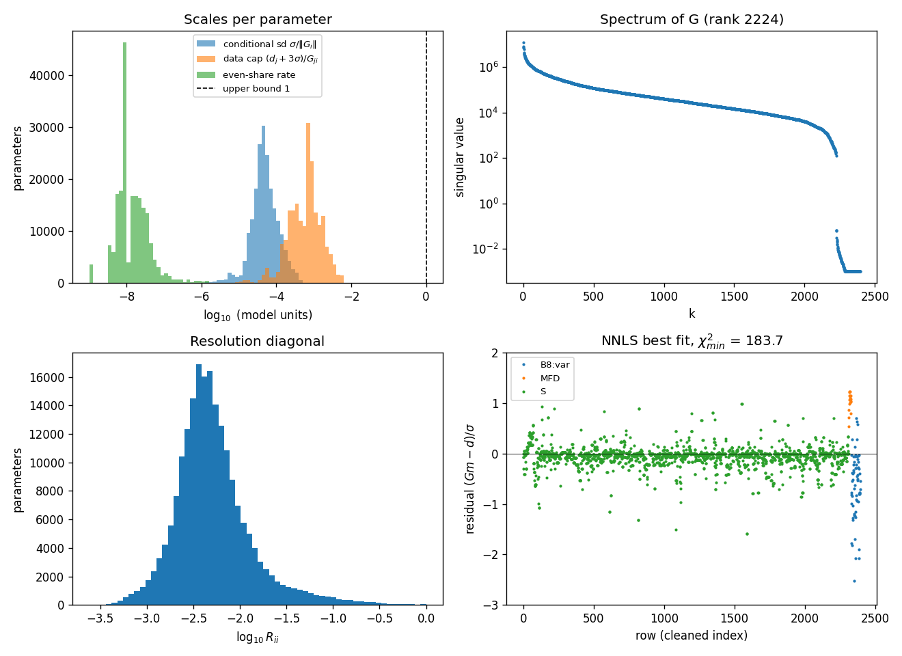
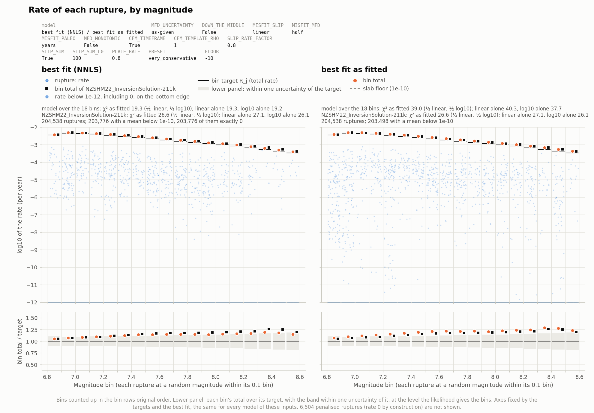
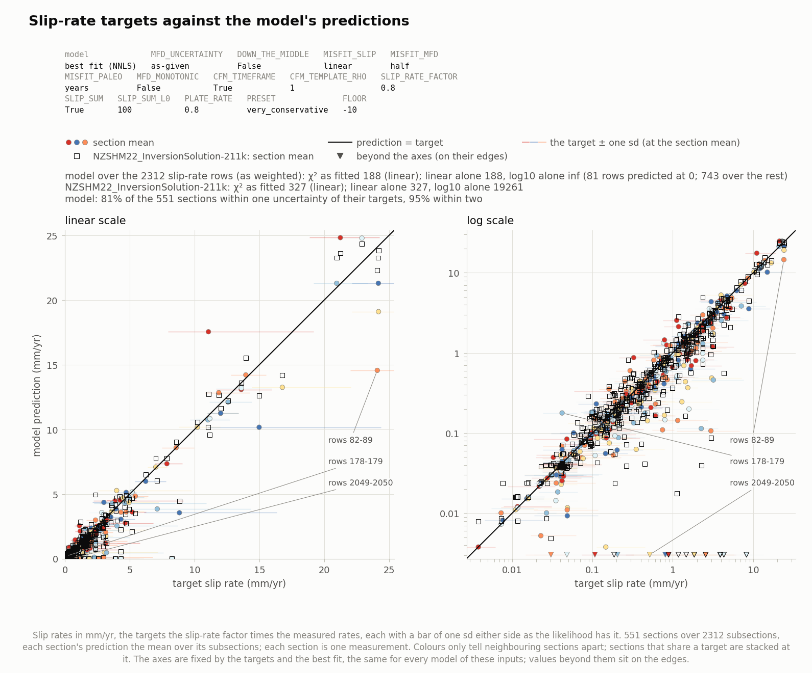
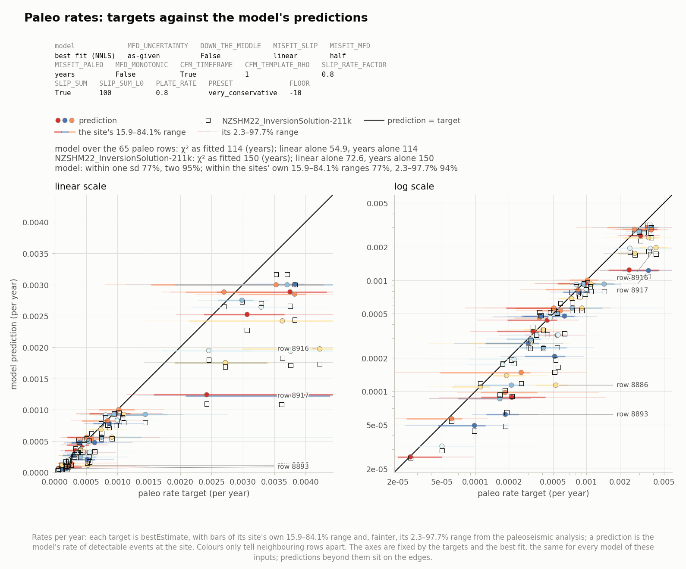
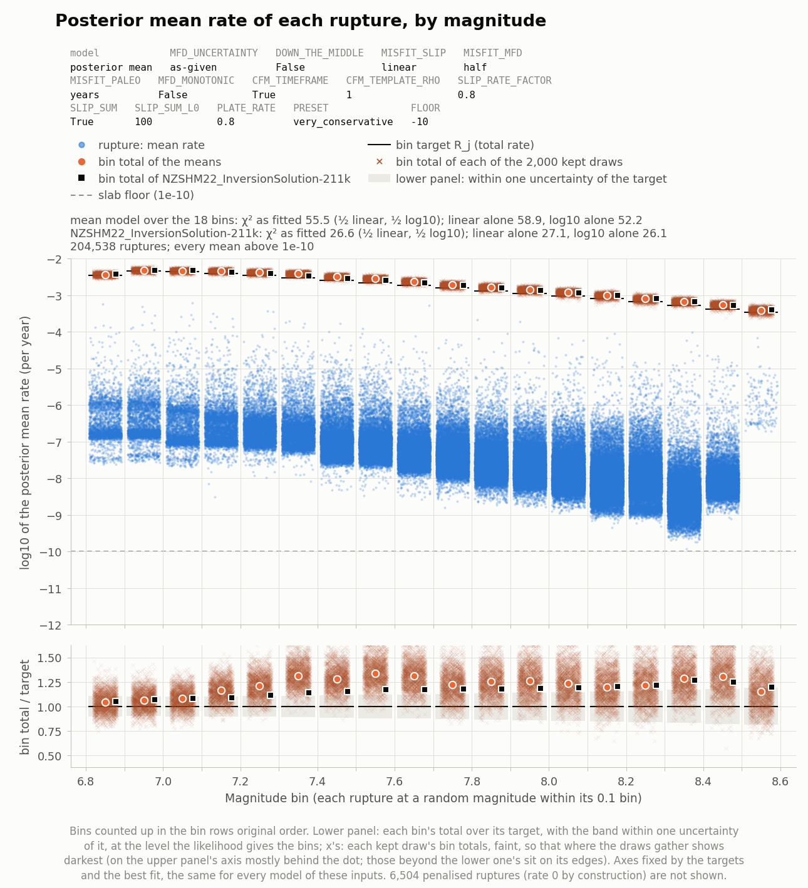
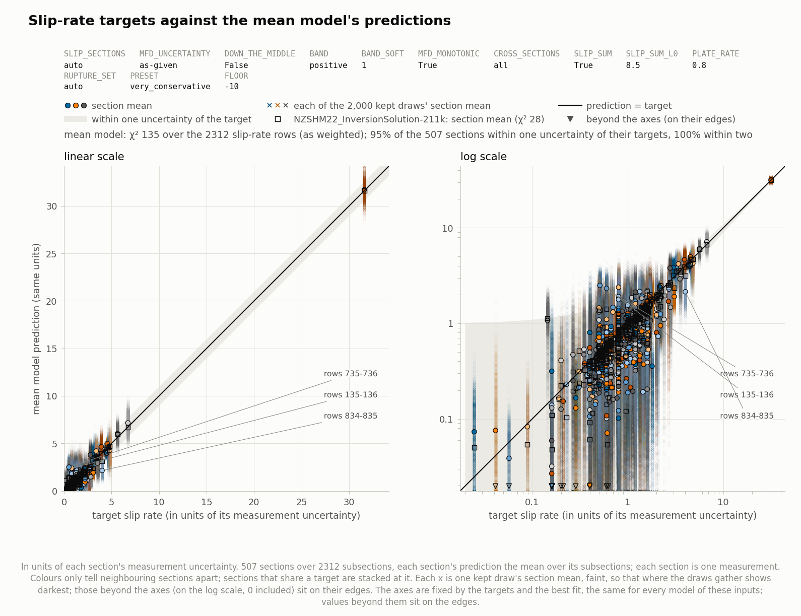
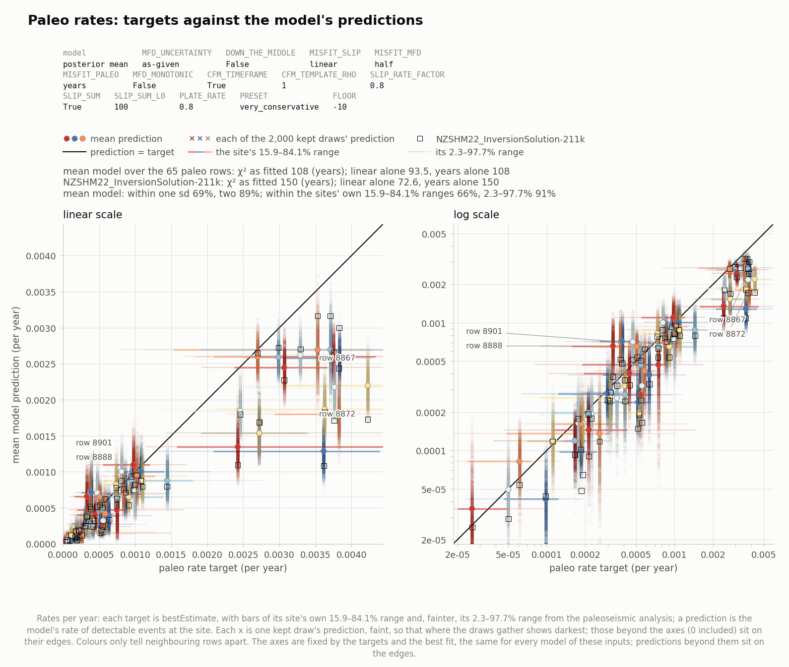
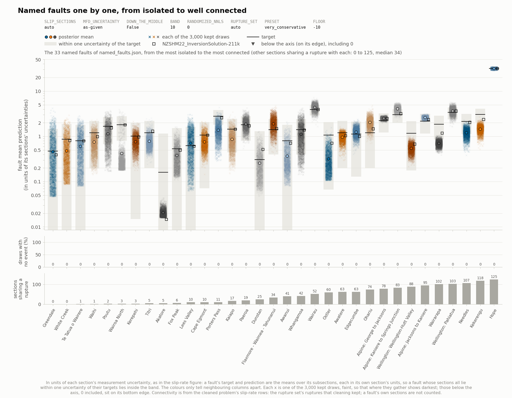
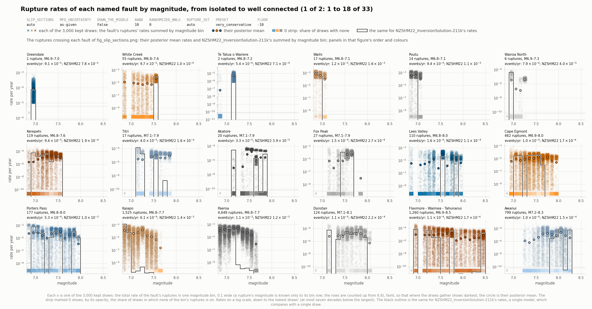
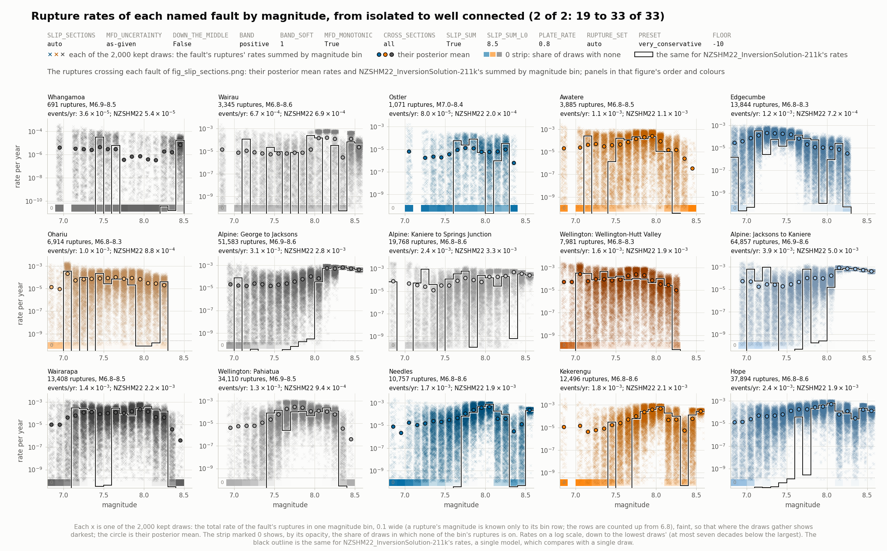

# Posterior sampling of NZSHM22 rupture rates

The NZSHM22 inversion asks for the annual rate of every rupture in a rupture set such that the predicted slip rates, the regional magnitude-frequency distribution (MFD) and the paleoseismic event rates match their targets within their uncertainties: a linear system *G m* ≈ *d* with each row already divided by its uncertainty. The NZSHM22 solutions find one such model by simulated annealing. This workflow instead maps the whole set of models consistent with the data and a stated prior: a Bayesian posterior, sampled by an exact Gibbs sampler, from which it reports posterior means and spreads of every rupture rate, of every predicted datum and of sums such as fault event rates, together with weighted representative models for hazard calculations. The sections below follow the notebook `cru_workflow.ipynb` step by step; each figure is one this run wrote.

## 1. Inputs and configuration

The inputs are the inversion matrices in `NZSHM22_Matrices-211k`: `cru_A.txt` (*G*, 8,928 rows by 211,042 ruptures, 9.4 million nonzeros) and `cru_D.txt` (*d*). The rows are the subsections’ slip rates, the MFD bins, the paleoseismic event rates, and penalty rows that force some ruptures to zero. The OpenSHA solution for the same rupture set (`NZSHM22_InversionSolution-211k`) supplies the fault geometry and named faults for the figures, and a reference model drawn in black on every figure. One configuration cell sets everything; this run used:

| setting | value | meaning |
|---|---|---|
| SLIP_SECTIONS | 'auto' | how the slip-rate rows count (’auto’: each fault section’s slip rate as one measurement, however many subsections it is copied to) |
| MFD_UNCERTAINTY | 'as-given' | the MFD bins’ uncertainty level (’as-given’: as the inputs give them) |
| MISFIT_SLIP | 'linear' | the slip rates scored linearly, by their split normals; every prediction kept above zero |
| MISFIT_MFD | 'half' | half linear, half log: half their Gaussians plus half the Gaussian in log10, the geometric mean of the two densities, with the same sds; every prediction kept above zero |
| MISFIT_PALEO | 'years' | the paleo rows scored by each site’s recurrence-interval PDF in years; every prediction kept above zero |
| CFM_SLIPRATES | True | each slip rate a split normal in mm/yr from the NZ Community Fault Model corrected for its timeframe (CFM_TIMEFRAME) and scaled as a whole by 0.8, the slip sums too |
| CFM_TIMEFRAME | True | each fault’s slip rate corrected for its timeframe (Coffey et al.): a split normal fitted to the corrected distribution’s 16%, 50% and 84% points (its median and body exactly), no further multiplier |
| CFM_TEMPLATE_RHO | 1 | faults of quality codes 2–5 sharing an identical SR_pref / SR_min / SR_max treated as correlated, each one’s rows weighted 1/√(1 + (n − 1) × 1) for a group of n |
| CFM_RATE_LINKS | True | also the faults of any quality code whose rate the CFM borrowed from another’s (named in its comment as the source, or an identical triple on an adjacent trace or a fault of the same name), each weighted 1/√(1 + m × ρ) for the m faults it is correlated with |
| SLIP_RATE_FACTOR | 0.8 | the assumed fraction of each fault’s slip rate the ruptures take up, scaling each slip-rate distribution as a whole, target and sd (the inputs’ own) |
| CROSS_SECTIONS | 'all' | the strips of cross-sections perpendicular to the plate motion that SLIP_SUM and PLATE_RATE use, 8.5 km wide over all of New Zealand |
| SLIP_SUM | True | the slip along the plate motion (each fault’s slip vector projected on it) summed along each cross-section perpendicular to it, against the targets’ sums (a soft term) |
| SLIP_SUM_L0 | 100 | the summed slip rates’ weight: each 100 km of the plate boundary counts as one measurement |
| PLATE_RATE | 0.8 | each strip’s share of the plate rate at most 0.8 (a hard constraint, gibbs.py --plate-rate; PLATE_RATE = True: at SLIP_RATE_FACTOR) |
| DOWN_THE_MIDDLE | False | no balance term: the Gaussian misfit alone |
| FLOOR | -10 | the lowest rate an active rupture can take, 10-10 per year |
| PRESET | 'very_conservative' | 2 replicates × 8 chains × 300,000 sweeps (burn-in 5,000, a draw kept every 32) |
| REPRESENTATIVES | 100 | weighted representative models selected for hazard |

## 2. Cleaning and diagnostics

Cleaning (`preliminaries.py`) turns the raw system into the problem the sampler sees. The 16 penalty rows with very large entries fix 6,203 ruptures at zero, and 301 soft zero-forcing rows fix 301 more, so 6,504 ruptures are removed (at rate 0 in every output). 6,216 rows that then hold no remaining rupture add a constant χ² of 291.3 that no model can change, and are dropped. What remains is 2,395 rows by 204,538 ruptures: 2,312 slip-rate rows, 18 MFD bins and 65 paleo rows. The slip-rate rows form 551 fault sections; each section’s rows are divided by √k for its k subsections, so a section’s slip rate counts once rather than k times. The MFD bin targets run from 0.00034 to 0.0046 per year and sum to 0.0372 per year, with relative uncertainties of 9.9% to 18.9%. If the stated uncertainties are right, a model drawn from the posterior should have χ² near 382 ± 26: this is the *fit check*, for the Gaussians; with the paleo rows scored by their sites’ recurrence-interval PDFs, each site’s own expected misfit replaces its Gaussian share in the fit check used below (section 7). The diagnostics (Figure 1) show how weakly individual rates are determined: *G* has rank 2,224, and the median diagonal of the resolution matrix is 0.005, so the data fix sums of rates far better than single rates. There are also 973,207 pairs of near-duplicate ruptures (cosine similarity above 0.99), which the sampler handles with swap moves.

*Figure 1.* Cleaning diagnostics. Top left: per-rupture scales (the rate at which one rupture alone moves a prediction by one uncertainty, the most any datum allows it, and an even share of each datum). Top right: the singular values of *G*. Bottom left: the resolution diagonal. Bottom right: the best fit’s residuals, row by row, coloured by data type. `prelim.png`

## 3. The best fit (no prior)

Cleaning also computes the best nonnegative least-squares fit (Lawson–Hanson NNLS, 28 s). It reaches χ² = 183.7 over the 2,395 rows with only 762 ruptures above zero: 109.4 from the slip rates, 19.4 from the MFD bins and 54.9 from the paleo rows. Its total rate is 0.0414 per year, +11.4% against the bin targets, with every bin between +5.6% and +19.4%. A fit chooses among all the rates to match far fewer numbers, so its χ² lies well below the fit check; it is a reference with no prior and the starting point of the chains, not a sample of the posterior. Figures 2–4 show its fit to each data type, with NZSHM22_InversionSolution-211k for comparison; the same three figures for the posterior follow in step 9.

*Figure 2.* Best fit: each rupture’s rate against its magnitude bin (ruptures at zero on the axis at the bottom; dashed: the slab floor), each bin’s target (black line) and total (orange), and NZSHM22_InversionSolution-211k’s bin totals (black squares). Lower panel: each bin’s total over its target, with the band within one uncertainty. `fig_rate_magnitude_nnls.png`

*Figure 3.* Best fit: each fault section’s slip-rate target against the predicted section mean, in mm/yr, on linear and log scales; open squares are the reference’s predictions. Each target’s bar spans one sd either side. `fig_slip_rates_nnls.png`

*Figure 4.* Best fit: each paleo row’s target against its prediction, in events per year, on linear and log scales; each target’s bars span its site’s own 15.9–84.1% and 2.3–97.7% ranges. `fig_paleo_rates_nnls.png`

## 4. The model: prior, likelihood and constraints

**Prior.** Each rupture is either off, with a rate of exactly zero, or on, with a rate that is uniform in log rate from 10-10 per year up to its magnitude bin’s target rate (spike-and-slab). The top is soft, a Gaussian shoulder as wide as the bin’s own uncertainty, since no single rupture can carry more than its bin’s total. The fraction of ruptures switched on is estimated separately in each bin (uniform prior on each fraction), so the data decide how many ruptures are active, and the prior puts no pressure on the bin totals. **Likelihood.** Gaussian, exp(−χ²/2) with the stated uncertainties. **Positivity.** In addition, each subsection’s slip rate, each paleo rate and each MFD bin must be above zero, so at least one rupture is on in each, with no other limit: a hard constraint. **The paleo misfit.** The paleo rows leave the Gaussian likelihood: each is scored instead by its site’s recurrence-interval PDF from the paleoseismic analysis, −2 ln of its density in years, measured from its minimum, a curve through the site’s 2.275, 15.865, 84.135 and 97.725% points with its mode at 1/bestEstimate exactly (the rupture set’s paleo_constraint_data.json); 2 site(s) fit their quantiles to worse than 0.05 decades. The ranges are lopsided, and the Gaussian caps a site’s misfit, so this penalizes paleo rates predicted well below their targets far more. It is kept exactly by the same Metropolis steps as the soft band, and recorded apart; χ² still counts the paleo rows’ Gaussian misfit, for comparison. **Misfit by data group** (MISFIT_SLIP 'linear', MISFIT_MFD 'half', MISFIT_PALEO 'years'). The slip rates are scored by their split normals; the MFD bins by half their Gaussians and half a Gaussian in log10 with the same sds; the paleo rows by their recurrence-interval PDFs in years. A half-and-half group’s score is the geometric mean of its two densities, so each measurement still counts once; away from a target a log part grows with the decades off. Every prediction is kept above zero, each log part is kept exactly by Metropolis steps, and χ² as fitted counts every part. **Slip rates from the CFM.** Each subsection’s slip-rate row is rebuilt from its parent fault’s line of the NZ Community Fault Model (SR_pref, SR_min, SR_max in mm/yr): a split normal in the slip rate itself, scaled as a whole by 0.8 (SLIP_RATE_FACTOR, the assumed fraction of the slip rate the ruptures take up): each fault’s numbers corrected for its slip-rate timeframe (CFM_TIMEFRAME; Coffey et al.: the CFM’s range widened by the distribution of true over measured slip rate for the few earthquakes a short timeframe captures, rebuilt in full from the paper’s Table S4), and the split normal fitted to that corrected distribution: through its 16%, 50% and 84% points, or, for the most right-skewed faults, fitted in log10 of the slip rate and converted, whichever is closest to it in Kullback–Leibler divergence (its median and body exactly for most faults), times 0.8. The inputs’ Gaussian has one sd, twice the half range, for both sides; here each side has its own, and their mean is the unit of the rows, of χ² and of the summed slip rates, which sum the modes. The misfit, each residual weighed by its own side’s sd, is evaluated exactly in every update. **The plate rate.** In each 8.5-km strip of cross-sections perpendicular to the plate motion over all of New Zealand, the crustal faults must take up at most 0.8 of the Pacific–Australia plate rate, each fault’s slip vector projected on the local plate motion and averaged over the strip’s cross-sections (`plate_rate.txt`). **Summed slip rates.** A soft term in the misfit: along every cross-section perpendicular to the plate motion over all of New Zealand, the model’s slip along the plate motion added up (each fault’s slip vector projected on it) should match the targets’ added up, within that sum’s uncertainty, each subsection counting once in all; each 100 km of the plate boundary counts as one measurement, and it is recorded apart from χ² (`plate_rate.txt`).

## 5. Sampling

The sampler (`gibbs.py`, a C kernel run from Python) is an exact Gibbs sampler: it updates one rupture at a time, drawing its rate from its exact conditional distribution by a slice sampler in log rate, with an exact step that switches the rupture on or off. Each update is restricted to the rates that keep the hard constraints (no slip-rate or paleo or MFD bin row predicted at zero, the plate-rate limit). The summed slip rates are quadratic in the rates, so they enter the exact updates as extra rows of the misfit. Swap moves exchange the rates of near-duplicate ruptures (641,554 pairs; 0.6% of swaps accepted), and the fraction on in each bin is redrawn after every sweep. The chains start from the best fit, with 10 ruptures switched on at twice the slab floor so that none of the 51 rows it predicts at zero is left there; in 8 of 8 chains it took up more than the plate-rate limit, and their rates were scaled down (by a factor 0.982 at most). Each of the 2 replicates ran 8 chains for 300,000 sweeps in 4.1–4.2 hours, keeping 9,219 draws per chain after burn-in: 147,504 recorded draws in all. No recorded draw broke the hard constraints. The runs keep running summaries rather than every draw, plus whole draws for the representative models and the figures.

## 6. Convergence

`check_convergence.py` judges each replicate against the targets of its preset: verdicts main_rep0 CHECK, main_rep1 CHECK (main_rep0: each bin's fraction on needs 4,000 effective draws (fewest 2,034); main_rep1: each bin's fraction on needs 4,000 effective draws (fewest 2,227)). For χ² and the total rate the effective sample sizes are 28,150–29,130 and 37,730–45,510 per replicate, and for the rupture rates the 5th percentile is 59,900. About 1,500–1,501 ruptures are on in each draw. With so many rates even perfectly independent draws give a worst R̂ above 1, so R̂ is judged against that noise baseline (1.0003 here). A small minority of ruptures mixes slowly, mostly ruptures that switch on and off rarely: 16–18 ruptures per replicate with R̂ above the threshold (worst 1.042–1.053), carrying 1.4–2.4% of the total rate, with at least 244 effective draws each. The replicates agree rupture by rupture as independent runs should: the standardized differences of their mean log rates have a standard deviation of 0.983 (1 expected), with 0.22% beyond 3 (0.27% expected).

| replicate | χ² (mean) | effective draws: χ² / total rate | worst R̂ (baseline) | slow-mixing ruptures (share of rate) | verdict |
|---|---|---|---|---|---|
| main_rep0 | 1032 | 28,150 / 37,730 | 1.0423 (1.0003) | 18 (2.4%) | CHECK |
| main_rep1 | 1032 | 29,130 / 45,510 | 1.0528 (1.0003) | 16 (1.4%) | CHECK |

## 7. Fit to the data

The posterior’s χ² as fitted is 1032.2 ± 35.0, against the fit check as fitted, 404.1 ± 27.2 (χ² as the likelihood scores the data: each group as MISFIT_SLIP, MISFIT_MFD and MISFIT_PALEO score it, with its own expected share; cleaning’s, for the Gaussians alone: 382 ± 26): above it (+23.1 standard deviations). A χ² above the fit check means some data are fitted worse than their uncertainties allow, or the uncertainties are too small. The row-block fit (`block_fit.py`) splits χ² by data type: a block’s χ² per measurement near 1 is fitted as its uncertainties say, below 1 more closely, above 1 worse. In the table, the “mean model” is the misfit of the posterior-mean prediction and the “spread” is the posterior variance of the predictions; the two add up to χ².

| row block | rows | measurements | χ² over the draws | per measurement | z | mean model | spread |
|---|---|---|---|---|---|---|---|
| slip rates (S) | 2,312 | 298.9 | 824.2 ± 34.8 | 2.76 | +23.8 | 406.1 | 418.1 |
| MFD bins (MFD) | 18 | 17.9 | 71.3 ± 12.3 | 3.99 | +9.0 | 55.5 | 15.8 |
| paleo (B8:var) | 65 | 87.3 | 136.7 ± 13.7 | 1.57 | +3.4 | 108.4 | 28.3 |
| total | 2,395 | 404.1 | 1032.2 ± 35.0 | 2.55 | +23.1 | 570.0 | 462.2 |

Each run also records the terms it adds beside χ², each on χ²’s scale and not counted in it. **The MFD misfit in log10**: 64.5 on average per replicate (5–95% of draws 48.4–82.2), in the likelihood in place of the bins’ Gaussian, which χ² still counts. **The paleo misfit**: 136.6–136.8 on average per replicate (5–95% of draws 115.0–160.0), in the likelihood in place of the paleo rows’ Gaussian, which χ² still counts. **The summed slip rates**: 30.6 on average per replicate (5–95% 23.6–39.2), against about 14.1 expected if the model matched the truth (one per 100 km of strip); `plate_rate.txt` lists the strips furthest from their target sums. **The plate rate**: every strip is inside the limits in 100.0% of the 2,000 kept draws, as a hard constraint requires; the strip closest to the limit, +59 (173.12° E, 41.81° S, mostly Hope and Awatere in the fault model), reaches 0.797 at the kept draws’ 97.5%.

## 8. Posterior tables, rate vectors and representative models

`make_tables.py` pools the replicates into per-rupture, per-subsection and per-bin tables and into rate vectors (`rate_vectors.csv`): for each of the 211,042 ruptures its posterior mean, median, mode and 2.3%, 15.9%, 84.1% and 97.7% points. Most ruptures are off in most draws, so their medians and modes are zero; sums such as fault or bin rates must be built from the means. The posterior-mean total rate is 0.0442 per year, +18.8% against the bin targets (NZSHM22_InversionSolution-211k: 0.0419); the bin totals sit a median +22.7% from their targets (+4.3% to +33.4%), against the best fit’s +14.6%. About 23% of each subsection’s posterior rate (the median) is carried by ruptures whose rates are individually below what the data can detect. `select_draws.py` then picks 100 weighted representative models from the 2,000 kept draws, clustering them by their rates per subsection and magnitude bin, for use in hazard calculations. With 100, the weighted mean total rate is off the exact mean by -0.2%, the worst bin by +2.4%, and 75% of subsection means are within 10% (the tolerance asks for 90%); the selection misses some tolerances, so the posterior-mean rate vector remains the exact input for mean hazard.

## 9. The posterior’s fit, data type by data type

The next three figures repeat Figures 2–4 for the posterior. Each coloured dot is the posterior mean, and each faint x one of the kept draws, so where the draws gather shows darkest; open black squares are NZSHM22_InversionSolution-211k. **Rates by magnitude** (Figure 5): the posterior spreads each bin’s rate over many ruptures at low mean rates, where the best fit puts a few ruptures high and the rest at zero. The bin totals are +4.6% to +8.2% from their targets below M7.1 and +15.3% to +33.6% from M7.1 upward. **Slip rates** (Figure 6): 57% of the 551 sections’ posterior means lie within one measurement uncertainty of their targets and 87% within two (NZSHM22_InversionSolution-211k: 80% within one), with a median ratio of prediction to target of 0.88 (mean-model χ² 406.1; NZSHM22_InversionSolution-211k: 326.5). **Paleo rates** (Figure 7): the posterior underpredicts them, with a median ratio of prediction to target of 0.80; 69% of rows lie within one uncertainty and 89% within two (mean-model χ² 108.4; NZSHM22_InversionSolution-211k: 150.3).

*Figure 5.* Posterior: each rupture’s posterior mean rate against its magnitude bin (dashed: the slab floor; means below the axis, 0 included, on it), each bin’s target (black line) and total of the means (orange dot), and NZSHM22_InversionSolution-211k’s bin totals (black squares). Faint x’s: each kept draw’s bin totals. Lower panel: each bin’s total over its target. `fig_rate_magnitude.png`

*Figure 6.* Posterior: each fault section’s slip-rate target against its posterior-mean section mean (dots), in mm/yr, each target’s bar one sd either side. Faint x’s: each kept draw’s section means. Open squares: the reference. `fig_slip_rates.png`

*Figure 7.* Posterior: each paleo row’s target against its posterior-mean prediction (dots), in events per year, each target’s bars its site’s own 15.9–84.1% and 2.3–97.7% ranges. Faint x’s: each kept draw’s predictions. Open squares: the reference. `fig_paleo_rates.png`

## 10. Faults one by one

`plot_slip_sections.py` looks at 33 named faults, ordered from the most isolated (Greendale, which shares no rupture with any other section) to the most connected (Hope, which shares ruptures with 138). **Figure 8** shows each one’s mean slip-rate prediction against its target. Every one has an event in every draw (the middle panel is 0% throughout). The lowest ratio of prediction to target is Akatore’s (0.046 against 1.1, in units of its uncertainty). **the figures (not found)** count each one’s ruptures by rate: the posterior means spread rate over many ruptures at low rates, whereas a single draw switches on only a few ruptures per rate bin, at higher rates, as NZSHM22_InversionSolution-211k (black outline) does: a single model compares with a single draw, not with the mean. **Figures 9–10** sum each one’s rupture rates by magnitude bin, its rate of events of each size; the circles are the posterior means, the x’s the kept draws’ sums, and the strip marked 0 shows by its opacity how often a draw has no event in the bin.

*Figure 8.* Each column’s mean slip-rate prediction over its subsections (posterior mean: dot; kept draws: x’s; reference: open square) against its target (black line; grey: within one uncertainty), in units of its sections’ uncertainties. Below: the share of draws in which no rupture crossing it is on, and the number of other sections sharing a rupture with it. `fig_slip_sections.png`

*Figure 9.* Rupture rates by magnitude, first part: each column’s ruptures’ rates summed by magnitude bin for each kept draw (x’s), their posterior mean (circles) and the share of draws with no event in each bin (the strip marked 0), and the reference’s sums (black outline). `fig_slip_sections_ruptures_by_magnitude_1.png`

*Figure 10.* Rupture rates by magnitude, second part. `fig_slip_sections_ruptures_by_magnitude_2.png`

## 11. Output for OpenSHA

`make_solution.py` writes the posterior-mean rates as an OpenSHA fault-system solution’s rates file (`spikeslab/rates.csv`, one row per rupture of the rupture set, removed ruptures at zero), and the best fit’s as `nnls/rates.csv`. Before writing, it checks that the rates and the rupture set describe the same ruptures: 204,538 of 204,538 kept ruptures cross exactly the fault sections the rupture set lists, and each one’s magnitude lies in its bin. With `--zip` it also writes a complete archive that OpenSHA loads. Any representative model can be written the same way.

## 12. Points to keep in mind

- **The fit check.** χ² is +23.1 standard deviations from the fit check.
- **Paleo rates.** The posterior mean underpredicts them (median ratio 0.80).
- **Slow mixing.** 16–18 ruptures per replicate, carrying 1.4–2.4% of the total rate, mix slowly; their individual rates are less precise than the rest, though sums over many ruptures are not affected.
- **Convergence.** Not every replicate passes: main_rep0: each bin's fraction on needs 4,000 effective draws (fewest 2,034); main_rep1: each bin's fraction on needs 4,000 effective draws (fewest 2,227) (the report suggests longer runs).
- **Starts.** All 16 chains started from the same point (the best fit, with ruptures switched on for positivity); runs from dispersed starts remain untested.
- **Representative models.** The 100 representatives miss some of their tolerances; the posterior-mean rate vector is the exact input for mean hazard.
- **What the data determine.** Sums of rates (fault, subsection and bin rates) and the probability that a rupture exceeds about 10−5 per year are well determined; individual rates below that are largely set by the prior.
